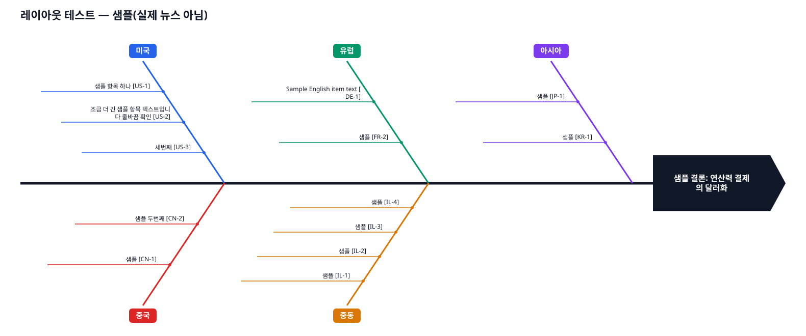

# News-Daily — 글로벌 뉴스 브리핑

9개국 주요 방송사·신문사 헤드라인을 모아 **팀원 → 팀장 → 임원** 구조로 선별·분석하고,
분야별로 연관된 뉴스 조각을 **피쉬본 다이어그램**으로 연결해 설명하는 Claude Code 프로젝트.

## 조직도

```
                       ┌──────────────┐
                       │  임원 (executive) │  분야별 피쉬본 + 업무 Flow 분석 + 시나리오
                       └──────▲───┬───┘
                    draft/final │   │ review 요청
                       ┌──────┴───▼───┐
                       │ 팀장 (team-lead) │  중요 뉴스 선별 · 이유 · 출처 / 임원 초안 검토
                       └──────▲───────┘
   ┌─────┬─────┬─────┬─────┼─────┬─────┬─────┬─────┐
  미국   한국   일본   독일   영국  프랑스 이스라엘 러시아  중국    팀원 9명 (reporter-<cc>)
  방송사 + 신문사 헤드라인 수집
```

## 실행

Claude Code에서:

```
/briefing              # 오늘(KST)
/briefing 2026-10-26   # 특정 날짜
```

| 단계 | 담당 | 결과물 |
|---|---|---|
| 1 | 팀원 9명 (병렬) | `data/<DATE>/raw/<cc>.json`, `data/<DATE>/teams/<cc>.md` |
| 2 | 팀장 — 선별 | `data/<DATE>/lead_digest.md` (TOP 15 · 국가별 TOP 3 · 이유 · 출처) |
| 3 | 임원 — 초안 | `data/<DATE>/fishbone/*.json`, `briefings/<DATE>/fishbone-*.svg`, `data/<DATE>/exec_draft.md` |
| 4 | 팀장 — 검토 | `data/<DATE>/lead_review.md` (출처 추적 · 연관성 타당성 · 누락) |
| 5 | 임원 — 최종 | **`briefings/<DATE>/briefing.md`** |

## 분야 (8개)
산업 · 비즈니스 · 주식 · 코인 · 각국 통화정책 · 신규/처리중 법안 · 미래 예측 · 국제 지정학

## 사용자 설정 프롬프트
분석 기준은 [`prompts/analysis-framework.md`](prompts/analysis-framework.md) 에 있습니다.
- 업무 Flow: 현상파악 → 세계 유사 사례 → 원인분석 → 논리구조 → 유사 사례 분석 → 본질(머스크 3법칙) → 시나리오별 결론
- 세계관 · "미국의 그림" 가설(H1~H4)은 매일 **지지/반대 근거 트래커**로 검증됩니다.

이 파일을 고치면 다음 브리핑부터 바로 반영됩니다.

## 구성 파일

| 경로 | 역할 |
|---|---|
| `config/sources.json` | 국가별 방송사/신문사 RSS·홈페이지 목록 (매체 추가·삭제는 여기서) |
| `scripts/collect_headlines.py` | RSS 수집기 (표준 라이브러리) |
| `scripts/fishbone.py` | 피쉬본 SVG 생성기 (표준 라이브러리) |
| `prompts/reporter-guide.md` | 팀원 공통 지침 · 출력 형식 |
| `.claude/agents/` | 팀원 9 · 팀장 · 임원 에이전트 정의 |
| `.claude/commands/briefing.md` | 전체 파이프라인 |

## 네트워크 주의
RSS 수집은 각 언론사 도메인에 직접 접속합니다. Claude Code 클라우드 환경에서는 환경 설정의
**Network access** 를 넓히거나 언론사 도메인을 Allowed domains 에 추가해야 합니다
([문서](https://code.claude.com/docs/en/cloud-environments#network-access)). 로컬 Claude Code에서는 별도 설정이 필요 없습니다.
수집이 막힌 매체는 팀원이 WebFetch/WebSearch로 보충하고, 그래도 안 되면 "수집 실패"로 기록합니다.

## 피쉬본 예시 (레이아웃 샘플)

