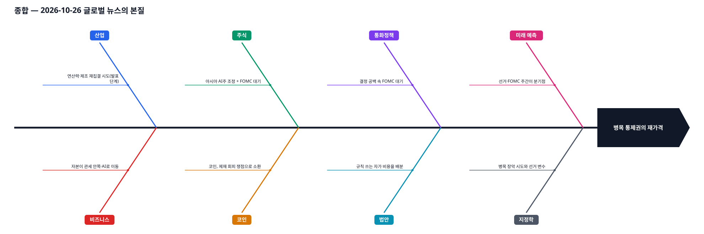
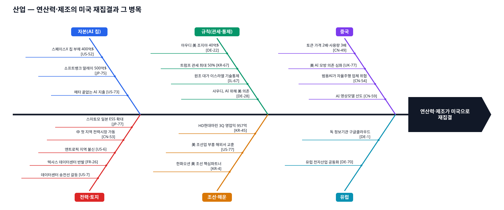
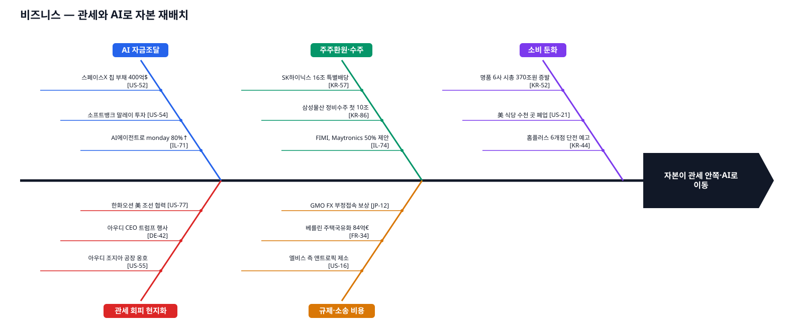
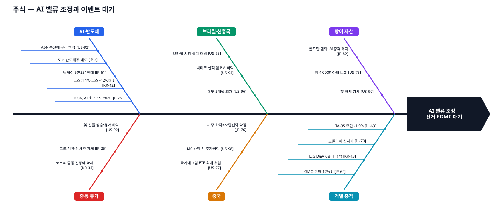
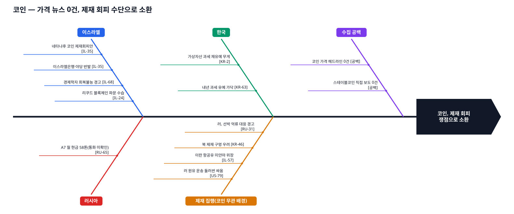
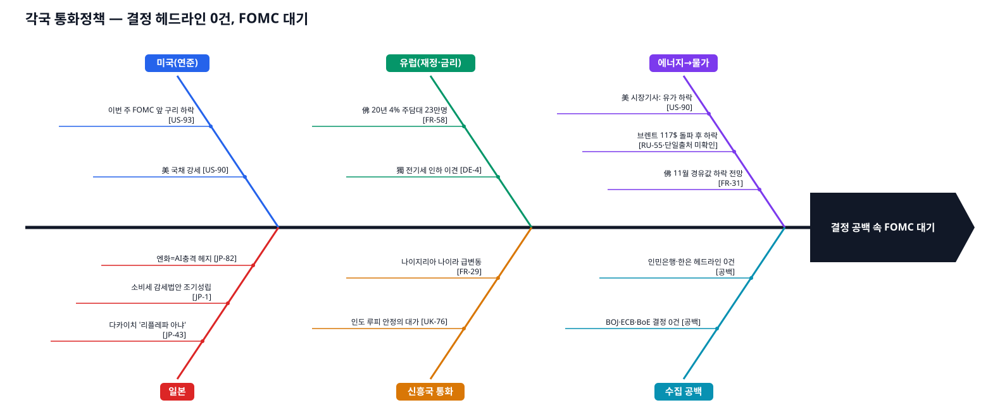
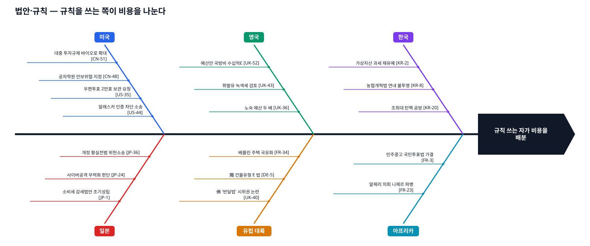
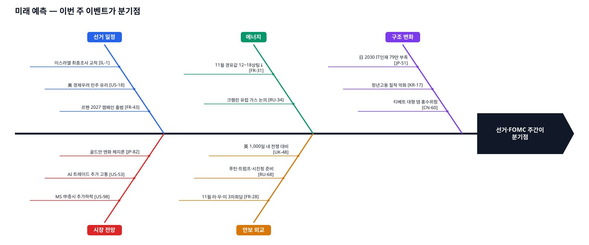
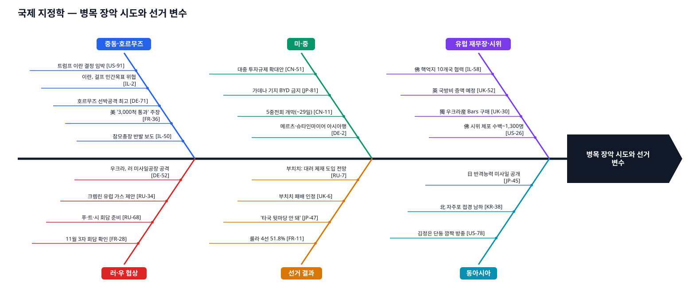

# 글로벌 뉴스 브리핑 — 2026-10-26

> 오늘의 본질: 🔎 미국은 군사력(호르무즈 통항 보장)과 관세·투자규제로 에너지·연산력·제조의 통로를 자기 쪽으로 다시 묶으려 한다. 그런데 열흘 사이에 몰린 선거(브라질·세르비아 10/25, 이스라엘 10/27, 미국 11/3)와 아시아 반도체주 중심의 AI주 조정이 그 통제력의 가격을 다시 매기고 있다.  (일론 머스크 3법칙으로 도출)

> 작성: 임원 최종본(final) · 입력: `data/2026-10-26/exec_draft.md`, `data/2026-10-26/lead_review.md`, `data/2026-10-26/lead_digest.md`, `data/2026-10-26/teams/*.md` · 수집 기준 2026-10-26 14:28~14:30 KST
> 표기: 사실 문장에는 출처 ID를 붙였다. 해석은 `🔎 해석`, 가설 대입은 `🧭 H1~H4`로 표시했다. 역사 사례(②⑤)는 오늘 수집분이 아니라 일반 역사 지식이므로 출처 ID가 없다.

### 본질 도출 (종합, 머스크 3법칙)
1. **의심한 가정**: (a) "이란 위기 = 유가 급등" — 정말 그런가? 급등 압력과 통항 유지가 함께 있는가? 호르무즈 선박 공격은 사상 최고라는 보도가 있다(Handelsblatt)[DE-71]. 그러나 같은 날 미국 시장 기사들은 유가 하락·후퇴를 전했고(Bloomberg·WSJ)[US-90][US-74][US-92], 미국은 상선 3,000척 이상 통과와 원유 15억 배럴 수출 지원을 내세웠다(BFMTV)[FR-36]. 한국 장 초반 기사는 중동발 긴장에 유가가 올랐다고 썼다(YTN)[KR-34]. 🔎 위험 신호는 최고치인데 확인된 가격 흐름은 하락 쪽이다. 시장은 '봉쇄'보다 '통항이 유지되는 고위험'에 가격을 매기고 있는 것으로 보인다. (브렌트 117달러 돌파 보도[RU-55]는 단일 출처·미확인이라 논거에서 뺐다.) (b) "AI는 멈추지 않는 성장축" — 같은 날 도쿄·서울에서 반도체주 중심의 매도가 나왔고[JP-4][KR-42][DE-73], 연준 회의를 앞두고 AI주 부진이 구리 값을 끌어내렸다[US-93]. 다만 미국 본장은 소폭 올랐다[US-90]. 일제히 매도한 것이 아니라 아시아 쪽에 쏠린 조정이다. (c) "중국은 고립되고 있다" — 브라질 대두·독일 정상 순방·북중 교량·글로벌거버넌스이니셔티브는 반대 방향이다[US-96][DE-2][US-78][CN-5].
2. **근본 요소**: 에너지 통로(호르무즈), 연산력 공급망(칩·전력·데이터센터), 제조 입지(관세 → 공장), 군사력(공습 선택지·유럽 재무장), 규칙(투자규제·선거 인증 소송·각국 예산안).
3. **재조립**: 🔎 미국은 통로(해협·칩·시장 접근)를 쥐고 통행료(관세·투자·기술통제)를 받는 방식으로 움직이고 있다. 그런데 열흘 사이에 몰린 선거와 아시아 중심의 AI주 조정이 그 방식의 정치적·재무적 비용을 다시 매기는 중이다 → 위 본질 한 문장.

## 3줄 요약
1. **중동 병목**: 트럼프는 이란 문제에서 "협상이냐 끝장내기냐" 결정이 임박했다고 말했다[US-91]. 이스라엘 참모총장은 총선(10/27) 직전 네타냐후의 이란 '작전' 지시에 반발했다고 보도됐다(N12 단독 → JPost)[IL-21][IL-50]. 호르무즈 선박 공격이 사상 최고라는 보도[DE-71]와 미국의 "3,000척 통과" 주장[FR-36]이 맞서는 가운데, 미국 시장 기사들은 유가 하락을 전했다[US-90][US-92]. 카타르 중재단은 테헤란을 방문했다[IL-33].
2. **연산력 자본과 조정**: 머스크는 스페이스X가 AI 칩용 부채 400억 달러를 조달했다고 말했고[US-52], 말레이시아 총리는 소프트뱅크가 500억 달러 투자를 계획한다고 밝혔다[JP-75]. 그러나 FOMC·빅테크 실적 주간을 앞두고 아시아에서는 반도체주를 중심으로 매도가 나왔다(닛케이·코스피·코스닥)[JP-4][JP-61][KR-42]. 미국 본장은 소폭 올랐다[US-90].
3. **선거 결과와 정렬**: 룰라가 51.8%로 4선에 성공했고[FR-11], 세르비아 부치치는 학생 주도 운동에 패배를 인정했다[UK-6]. 🔎 FT는 룰라 승리를 트럼프의 중남미 구상에 대한 타격으로 봤고[UK-26], 부치치는 학생 리스트가 봄까지 대러 제재를 도입할 것이라고 주장했다(TASS)[RU-7]. 크렘린은 11월 3자 회담과 미·중·러 정상회담 준비를 띄웠다[FR-28][RU-68].

## 미국의 그림 — 가설 트래커
| 가설 | 오늘의 지지 근거 | 오늘의 반대 근거 | 판단(강화/약화/변화없음) |
|---|---|---|---|
| H1 연산력 결제의 달러화 | 스페이스X 칩용 400억 달러 부채(머스크 발언)[US-52]. 소프트뱅크 말레이 500억 달러 계획(말레이 총리 발언·보도)[JP-75][US-54]. 사우디가 AI 우위를 위해 미국에 기댐[DE-28]. 미국이 원조 대가로 이스라엘 기술 통제를 요구[IL-67]. | 아시아 반도체주 중심 매도·"추가 고통" 회의론[JP-4][US-93][US-53]. 중국 토큰 가격 2배·사용량 3배, 자체 토큰 경제[CN-49]. 미국 내 송전선·데이터센터 반발[US-7][FR-26]. 골드만삭스는 AI 시장 충격의 헤지 수단으로 달러가 아니라 엔화를 꼽았다[JP-82]. 🔎 미국이 원유 15억 배럴 수출 지원을 내세운 점[FR-36]은 석유가 여전히 미국의 핵심 지렛대라는 신호로 읽힌다(해석). 🔎 금이 온스당 4,000달러 부근에 있다[US-75]. 탈달러 준비자산 수요로 읽을 수도 있으나 근거로서는 약하다. | **변화없음** — 자본 흐름은 지지, 가격·전력·헤지통화·석유 축은 반대. 서로 상쇄. |
| H2 가상세계 확장 | 🔎(간접·약함) 감원과 AI 에이전트 효과로 monday.com이 4월 이후 80% 올랐다[IL-71]. 주가 사실일 뿐, 가상경제 확장 → 달러 수요와의 연결은 출처에 없다. 미국 법원에서 AI 학습 저작권 다툼(엘비스 측 앤트로픽 제소)[US-16] — 🔎 디지털 자산의 권리 규칙이 미국에서 쓰인다는 신호. | 중국이 AI 영상 모델에서 앞선다는 보도[CN-59]. 생성형 AI 해킹으로 개인정보 820만 건 탈취[KR-85]. 가상경제→달러 수요를 직접 다룬 헤드라인 0건. | **변화없음** — 직접 근거 부족. |
| H3 IMEC·북극항로 / 중국 고립 | 대중 투자규제 바이오테크 확대안[CN-51]. 가데나 기지 BYD 금지[JP-81]. 공자학원 안보위협 지정[CN-48]. 한화오션의 미 조선업 재건 협력[KR-4][US-77] — 단, WSJ 본문 미확인이라 항로 개편과의 연결은 판단 유보. | 룰라 승리로 대중 교역 전망 개선[US-96]. 메르츠·슈타인마이어 중국 포함 아시아 순방[DE-2]. JAL 계열 LCC 중국 노선 확대[JP-27]. 중-파 경제회랑 홍보[CN-7]. 중국의 글로벌거버넌스이니셔티브(GGI) 보고서·포럼[CN-5][CN-6]. 홍콩 중재기구의 중동·아프리카 진출 모색[CN-63]. 김정은 신압록강대교 방중[US-78]. 사우디·튀르키예·파키스탄 테헤란 회동 예정[IL-19]. **IMEC·북극항로 직접 보도 0건**. | **약화** — 반대 근거가 수와 질에서 우세. 🔎 중국은 대안 제도·회랑을 적극 홍보하고 있어, 오늘 모습은 "고립"보다 "선택적 분리"에 가깝다. |
| H4 장기 분쟁 ↔ 스테이블코인 | 🔎 이란·이스라엘 긴장이 이어지고 있다(종결 여부는 미정 — 트럼프는 "협상" 선택지도 함께 언급)[US-91][IL-2]. 분쟁 국면에서 코인이 제재 회피 수단으로 거론됨[IL-35]. | 러·우·미 11월 3자 회담[FR-28] = 분쟁 종결 쪽 신호. 카타르 중재단의 테헤란 방문[IL-33], 사우디·튀르키예·파키스탄의 테헤란 회동 예정[IL-19][IL-51] = 중동 중재 신호. 러시아 A7은 달러 스테이블코인이 아닌 현금 실물망(현금의 통화는 미확인, 송금액은 루블로 보도)[RU-65] — 약한 반대 근거. 이스라엘안은 어떤 코인인지 미확인. **스테이블코인 직접 보도 0건**. | **변화없음(판단 유보)** — 전제(분쟁 장기화)는 중재 신호와 맞서 미정이고, 연결고리(달러 스테이블코인)의 증거는 0건. |

---

## 1. 산업

**① 현상파악**
- 머스크는 스페이스X가 AI 칩용 400억 달러 부채 조달을 마쳤다고 말했다(CNBC)[US-52]. 말레이시아 총리는 소프트뱅크가 500억 달러 AI 투자를 계획한다고 밝혔다(Nikkei Asia)[JP-75][US-54]. 두 건 모두 확정 계약 문서는 확인되지 않았다.
- 트럼프는 아우디가 미국에 40억 달러 공장을 짓는다고 발표했고(DW)[DE-22], "미국을 이용하면 관세를 50%까지 올리겠다, 공장을 되찾고 있다"고 말했다(한겨레)[KR-67]. WSJ는 한화오션을 미 조선업 부흥의 핵심 파트너로 조명했다[KR-4][US-77]. HD현대마린솔루션의 3분기 영업이익은 957억 원으로 2.2% 늘었다(연합뉴스)[KR-45].
- 미국 안에서는 데이터센터발 송전선 갈등(CNN)[US-7], 텍사스 공화당 유권자로 번지는 데이터센터 반대(RFI)[FR-26], 앤트로픽에 대한 시골 마을의 불신(CNN)[US-6]이 보도됐다.
- 사우디는 후티 압박 속에서 AI 우위를 위해 미국에 기댄다(DW)[DE-28]. 미국은 원조 대가로 이스라엘 기술 통제권을 요구한다(Globes)[IL-67]. 독일 정보기관은 구글 클라우드를 택했다(Tagesschau)[DE-1].
- 중국: AI 응용 붐으로 토큰 가격 2배·사용량 3배(Global Times)[CN-49], 첫 지역 전력시장 전면 가동(Caixin)[CN-53], 범용 AI가 자율주행 전문업체를 밀어낼 수 있다는 경고[CN-54]. Economist는 중국이 미국 AI 모방에 더 의존한다고 봤다[UK-77]. 유럽에선 "전자산업이 사라진다"는 논평(Handelsblatt)[DE-70]이 나왔다. 일본에서는 스미토모가 영국 경험을 살려 배터리 ESS를 늘린다(Nikkei Asia)[JP-77].

**② 세계 유사 사례**
- 1981~1988년 미국·일본: 자동차 수출자율규제(1981) 이후 혼다 오하이오 공장(1982), 도요타 켄터키 공장(1988) 등 일본 자동차의 미국 현지 생산.
- 2022~2024년 미국: CHIPS법·IRA 보조금과 수출통제 이후 TSMC 애리조나·삼성 테일러 공장 등 반도체·배터리 대미 투자 러시.
- 1998~2001년 미국: 통신 버블기 부채로 조달한 광섬유 과잉 투자.

**③ 원인분석**
- 직접 원인: 관세 위협[KR-67], AI 칩 확보 경쟁[US-52], 동맹국에 대한 기술·원조 연계 압박[IL-67].
- 구조적 원인: 연산력이 전력·토지·칩이라는 물리 자원에 묶여 있고[US-7][CN-53], 그 칩·클라우드 스택의 표준을 미국이 쥐고 있다[DE-1][DE-28]. 🔎 해석

**④ 논리구조**
- 관세 위협 → 동맹국 제조사의 대미 공장 투자(아우디[DE-22][US-55]) → 미국 내 고용·선거 성과(트럼프 행사에 아우디 CEO 참석[DE-42]). 한화오션의 조선 협력[KR-4][US-77]은 관세 회피 맥락이 출처에 없어 이 사슬에서 뺐다.
- 미국 AI 스택 독점 → 걸프·동남아·동맹이 달러 자본으로 접근권 구매(소프트뱅크·사우디) → 미국은 기술통제 조건 부과[IL-67].
- 데이터센터 확대 → 전력망·토지 수요 → 지역 반발[FR-26] → 공급 병목.
- 누가 이익을 보는가: 🔎 미국 정부(투자·고용·통제권), 칩·클라우드 공급자, 한국 조선. 손해: 독일 본국 생산기지(공동화 우려[DE-70]), 송전선 경유지 주민[US-7].

**⑤ 유사 사례 분석**
| 사례 | 그때의 전개 | 오늘과 같은 점 | 다른 점 |
|---|---|---|---|
| 1980년대 일본차 현지화 | 무역 마찰은 현지 생산으로 진정됐고, 일본 업체는 미국 내 점유율을 오히려 키웠다 | 관세 압박 → 공장 이전 | 오늘은 관세율 위협(50%)이 훨씬 노골적이고, 동시에 연산력이라는 새 자원이 걸려 있다 |
| 2022년 CHIPS·IRA | 대형 공장 발표는 많았지만 인력·전력·비용 문제로 일정이 늦어진 사례가 이어졌다 | 발표 중심, 전력·지역 제약 | 오늘은 보조금(당근)보다 관세(채찍) 비중이 크다 |
| 1998~2001년 통신 버블 | 부채로 지은 과잉 설비가 수요 둔화 때 부실이 됐다 | 부채로 조달한 AI 설비[US-52] | 오늘의 수요(토큰 사용량[CN-49])는 실제로 늘고 있다는 보도가 있다 |
- 🔎 "몇 번째 레오인가": 패권국이 시장 접근권을 미끼로 생산기지를 끌어오는 세 번째 회차(1980년대 자동차 → 2020년대 초 반도체 → 지금의 연산력·조선)로 읽힌다.

**⑥ 본질 (머스크 3법칙)**
- 의심한 가정: "투자 발표 = 산업 부활"인가? 발표 대부분이 발언·보도 단계다[US-52][JP-75]. "AI = 소프트웨어 산업"인가? 실제 병목은 전력·송전선·토지다[US-7][FR-26].
- 근본 요소: 연산력(칩), 에너지(전력망), 자본(달러 부채), 규칙(관세·기술통제).
- 본질: 🔎 **미국은 시장 접근권과 기술 스택을 통행료로 삼아 연산력·제조 자본을 자국으로 모으고 있지만, 최종 병목은 자국 안의 전력과 지역 동의다.**

**⑦ 시나리오별 결론**
| 시나리오 | 확률 | 트리거 | 관찰 지표 | 시사점 |
|---|---|---|---|---|
| 기본: 발표 지속·집행 지연 | 55% | 관세 협상 타결이 이어지고(캐나다[FR-38]) 공장 착공은 늦어짐 | 아우디 조지아 착공 일정, 데이터센터 인허가 분쟁 건수 | 한국 조선·전력기기 수혜, 독일 본국 공동화 논쟁 지속 |
| 상방: 연산력 투자 가속 | 20% | 빅테크 실적이 AI 지출을 정당화 | 메타 등 설비투자 가이던스[US-73], 소프트뱅크 계약 확정 | H1 지지 강화, 칩·전력 인프라 강세 |
| 하방: 전력·자금 병목 | 25% | AI주 조정 장기화 + 지역 반발이 선거 이슈화 | 텍사스 등 중간선거 결과[FR-26], 회사채 스프레드 | 부채 조달 AI 설비의 재평가, H1 속도 둔화 |
- 근거: 오늘 수집분은 "발표"가 많고 "집행" 증거는 적다 → 기본 시나리오에 가장 큰 비중. 피쉬본 머리도 "재집결 시도(발표 단계)"로 적었다. 반대 흐름(중국의 자체 AI·전력시장)은 '중국·기타(반대 흐름)' 뼈에 따로 모았다.

## 2. 비즈니스

**① 현상파악**
- AI 쪽 자금 조달: 스페이스X 400억 달러 칩 부채(머스크 발언)[US-52], 소프트뱅크 말레이 500억 달러 계획 보도[US-54]. 감원과 AI 에이전트 효과로 monday.com 주가가 4월 이후 80% 올랐다(Globes)[IL-71].
- 관세 회피 현지화: 아우디는 VW 구조조정·관세 속에서 조지아 공장 계획을 옹호했다(CNBC)[US-55]. FAZ·SZ는 아우디 CEO가 트럼프 선거 도우미가 됐다고 비판했고[DE-42][DE-54], Handelsblatt은 "생각만큼 무모하지 않다"고 봤다[DE-68].
- 한국: SK하이닉스는 키옥시아 지분 차익 16조 원 특별배당을 추진한다(단독 보도)[KR-57]. 삼성물산은 연간 정비사업 수주 첫 10조 원을 넘겼다(한국경제)[KR-86]. 홈플러스 6개 점포는 전기료 체납으로 단전 예고를 받았다[KR-44][KR-88].
- 규제·소송 비용: 엘비스 프레슬리 권리자들이 앤트로픽을 제소했다(NBC)[US-16]. 베를린 주택 국유화가 추진되면 보노비아가 84억 유로 손실 위기라는 보도가 있다(BFMTV)[FR-34]. GMO 사장은 FX 부정접속 대응이 불충분했다고 인정했다[JP-12].
- 소비 둔화: 중국발 소비 둔화로 유럽 명품 6개사 시가총액 370조 원 이상이 사라졌다(조선일보)[KR-52]. 미국에선 비용 상승·매출 감소로 식당 수천 곳이 문을 닫았다(CBS)[US-21].

**② 세계 유사 사례**
- 2017~2018년 미국: 세제 개편 뒤 해외 유보금 송금과 대규모 자사주 매입.
- 1999~2000년 미국: 닷컴·통신 기업의 부채·주식 조달 확대.
- 2015~2016년 중국·유럽: 중국 반부패·소비 둔화로 유럽 명품주 동반 약세.

**③ 원인분석**
- 직접 원인: 관세 압박[KR-67], AI 칩 확보 경쟁[US-52], 보유 지분 평가차익 실현[KR-57].
- 구조적 원인: 자본이 "관세 장벽 안쪽"과 "AI 연산력"으로 재배치되는 반면, 소비 쪽(중국 명품 수요, 미국 외식, 한국 유통)은 약해지고 있다[KR-52][US-21][KR-44]. 🔎 해석

**④ 논리구조**
- 관세 → 공장 현지화 → 본국 노조·정치권 반발(독일 내 논쟁[DE-42][DE-68]).
- AI 기대 → 부채·외국 투자 조달 → AI 수혜 기업 주가 상승(monday.com[IL-71]) ↔ 저작권·데이터 소송 비용 증가[US-16].
- 소비 둔화 → 유통·명품 실적 압박[KR-52][US-21][KR-44] → 🔎 자산 매각·구조조정 압력이 커질 수 있다(해석). 사모펀드 FIMI가 Maytronics 지분 50%에 2억 셰켈을 제시했다는 보도[IL-74]가 있으나, 이 거래와 소비 둔화의 관계는 출처에 없다.
- 누가 이익을 보는가: 🔎 AI 공급망 기업, 관세 장벽 안쪽에 먼저 들어간 기업, 현금 많은 사모펀드. 손해: 소비재·유통, 본국 생산 근로자.

**⑤ 유사 사례 분석**
| 사례 | 그때의 전개 | 같은 점 | 다른 점 |
|---|---|---|---|
| 2017~2018 유보금 송금 | 투자보다 자사주·배당으로 많이 흘렀다 | SK하이닉스 특별배당처럼 차익이 주주환원으로 감[KR-57] | 오늘은 AI 설비투자 압력이 동시에 크다 |
| 1999~2000 닷컴 조달 | 금리 상승기에 자금줄이 마르며 조정 | 대규모 부채 조달[US-52] | 수익 모델이 있는 AI 기업 사례도 있다[IL-71] |
| 2015~2016 명품 약세 | 중국 수요 회복과 함께 반등 | 중국발 수요 둔화[KR-52] | 오늘은 미중 디커플링이 겹쳐 회복 경로가 불확실 |

**⑥ 본질 (머스크 3법칙)**
- 의심한 가정: "기업 투자 = 성장 신호"인가? 투자는 관세 회피와 AI 경쟁이라는 방어적 동기가 크다[US-55][US-52].
- 근본 요소: 자본(부채·배당), 규칙(관세·저작권·국유화), 수요(소비 둔화).
- 본질: 🔎 **기업 자본은 성장보다 "규칙의 안쪽"(관세 장벽·AI 표준)에 자리를 잡으려고 움직이고 있고, 소비 쪽 약세가 그 비용을 키운다.**

**⑦ 시나리오별 결론**
| 시나리오 | 확률 | 트리거 | 관찰 지표 | 시사점 |
|---|---|---|---|---|
| 기본: 현지화·AI 조달 지속, 소비 약세 | 55% | 관세 위협 지속, 빅테크 실적 무난 | 대미 투자 발표 건수, 유통·명품 실적 | 방어적 투자가 이어지고 소비주는 부진 |
| 상방: 관세 협상 타결로 불확실성 해소 | 20% | 캐나다 등 무역협정 타결[FR-38] | 협정 발표, 관세율 고시 | 설비투자 집행 가속 |
| 하방: AI 조달 비용 급등 + 소비 위축 | 25% | AI주 조정 심화, FOMC 이후 금리 경로 불확실 | 회사채 발행 금리, 홈플러스류 유통 부실 확산 | 부채 조달 기업 압박, 구조조정 매물 증가 |
- 근거: 오늘 자본 이동 신호는 강하지만 소비 지표는 약해 기본 시나리오에 무게.

## 3. 주식

**① 현상파악**
- AI 트레이드 조정: 연준 회의를 앞두고 AI주가 약세를 보이자 구리 낙폭이 커졌다(Bloomberg)[US-93]. 도쿄 반도체주 매도(NHK)[JP-4], 닛케이평균은 10-26 오전 11시 기준 173엔 86전 내린 6만 251엔대(산케이)[JP-61]. 코스피 1% 안팎·코스닥 2%대 하락(10-26 장중)[KR-42]. 아시아 증시는 기술주 부담으로 밀렸다(Handelsblatt)[DE-73].
- 미국: 주식 소폭 상승, 국채 강세, 유가 하락(Bloomberg)[US-90]. CNBC 칼럼은 "AI 트레이드에 추가 고통이 와도 포기하지 않는다"고 했다[US-53].
- 중동: 코스피는 중동발 긴장에 장 초반 약세[KR-34], 도쿄에선 석유·상사주가 강세[JP-25].
- 신흥국: 빅테크 실적을 앞두고 신흥국 증시 하락[US-94], 브라질 시장은 룰라 승리에 급락 대비[US-95], 대두는 2개월 최저[US-96].
- 중국: '국가대표팀' ETF에 무역전쟁 급락 이후 최대 자금 유입[US-97], 모건스탠리는 바닥 전 추가 하락을 예상[US-98]. Nikkei Asia는 AI주 하락이 중국 자립 전략의 약점이라고 짚었다[JP-76].
- 방어 자산: 골드만삭스 "엔화가 AI 충격 헤지로 매력 커져"[JP-82], 금은 온스당 4,000달러 아래 보합[US-75].
- 개별: GMO 한때 12% 넘게 하락(부정접속)[JP-62], KOA 한때 15.7% 상승(AI용 호조)[JP-26], LIG D&A 6%대 급락(방사청 추가 제재 검토)[KR-43], 모빌아이 신저가[IL-70], TA-35 주간 -1.9%[IL-69], MOEX 0.1% 상승 출발[RU-26]. 한국 증시 대기자금은 넉 달 새 51조 원 줄었는데 개인은 고위험 투자를 늘렸다[KR-50].

**② 세계 유사 사례**
- 2000년 미국: 3월 나스닥 정점 이후 기술주 조정.
- 2024년 8월 일본: BOJ 금리 인상과 미국 고용 둔화가 겹쳐 엔캐리 청산, 8월 5일 닛케이 하루 12.4% 급락.
- 2022년 브라질: 룰라 당선 뒤 재정 우려로 브라질 자산 변동성 확대.

**③ 원인분석**
- 직접 원인: FOMC·빅테크 실적 주간 대기[US-93][US-94], 중동 긴장[KR-34], 브라질 선거 결과[US-95].
- 구조적 원인: 🔎 세계 증시가 AI라는 하나의 테마에 쏠려 있어, 같은 요인에 아시아 반도체주(일·한)와 중국 AI주가 함께 흔들렸다[JP-4][KR-42][JP-76]. 미국 본장은 소폭 상승해[US-90] '동시 매도'는 아니었다.

**④ 논리구조**
- AI 지출 회의론[US-73] → 반도체·AI주 매도 → 구리 등 원자재 동반 하락[US-93] → 엔화·국채·금 같은 헤지 수요[JP-82][US-90][US-75].
- 이란 위기 → 유가 변동 → 에너지 수입국(한국) 약세·자원 상사(일본) 강세[KR-34][JP-25].
- 룰라 승리 → 중국 교역 기대 → 대두 하락[US-96], 브라질 자산 급락 대비[US-95].
- 누가 이익을 보는가: 🔎 현금·헤지 자산 보유자, 원유 대체 공급자 관련주. 손해: AI 레버리지 개인 투자자(한국 고위험 투자 증가[KR-50]).

**⑤ 유사 사례 분석**
| 사례 | 그때 | 같은 점 | 다른 점 |
|---|---|---|---|
| 2000년 나스닥 | 실적 기대 미달 → 2년 넘는 하락 | 단일 테마 쏠림 | 오늘은 하루 조정이며, 실적이 나오기 전이다 |
| 2024년 8월 엔캐리 청산 | 급락 뒤 수주 안에 상당 부분 회복 | 엔화가 위험 회피 통화로 부각[JP-82] | 오늘은 BOJ 결정 헤드라인이 없다(수집 공백) |
| 2022년 브라질 | 당선 직후 변동성 뒤 재정 틀에 따라 방향 결정 | 룰라 승리·재정 우려[UK-5] | 이번엔 보우소나루 측 불복이 공식화됐다[DE-79] |

**⑥ 본질 (머스크 3법칙)**
- 의심한 가정: "오늘 하락 = AI 거품 붕괴"인가? 미국 본장은 소폭 올랐다[US-90]. 한 번의 조정과 추세 전환은 다르다.
- 근본 요소: 자본 쏠림(AI), 금리 경로(FOMC), 에너지 가격(호르무즈), 정치 이벤트(선거).
- 본질: 🔎 **세계 증시는 AI라는 단일 담보에 기대고 있어서, 이번 주 이벤트(FOMC·빅테크 실적·선거)가 그 담보 가치를 다시 매기는 동안 흔들린다. 오늘 그 흔들림은 아시아 반도체주에 집중됐다.**

**⑦ 시나리오별 결론**
| 시나리오 | 확률 | 트리거 | 관찰 지표 | 시사점 |
|---|---|---|---|---|
| 기본: 박스권 변동, 이벤트 소화 | 50% | FOMC·빅테크 실적이 예상 범위 | 닛케이·코스피 반도체 비중주, 구리 가격 | 테마 쏠림 유지, 변동성 높음 |
| 상방: 실적이 AI 지출 정당화 | 20% | 빅테크 가이던스 상향 | 메타 등 설비투자 가이던스[US-73] | AI·반도체 재반등, H1 지지 |
| 하방/꼬리위험: 이란 공습 + AI 실망 동시 발생 | 30% | 미국 대규모 공습 결정[US-1], 실적 실망 | 브렌트, 엔화, 호르무즈 사건 수 | 에너지 수입국 증시 급락, 엔화·금 강세 |
- 근거: 이란 결정 임박[US-91]과 실적 주간이 겹쳐 꼬리위험 비중을 평소보다 높게 뒀다.

## 4. 코인

> 수집 공백: 코인 가격·스테이블코인을 직접 다룬 헤드라인은 0건이다. 이 분야는 제재 회피·과세 관련 뉴스만으로 분석한다.

**① 현상파악**
- 네타냐후가 국제 제재 가능성에 대비해 암호화폐로 제재를 피하자고 제안했다. 이스라엘은행과 야당 대표들이 비판했다(ToI)[IL-35]. 경제학자들은 "되돌릴 수 없는 피해"를 경고했다[IL-36][IL-68]. 리쿠드는 '블록체인 파문' 수습에 나섰다(N12)[IL-24]. 제안의 구체 내용(어떤 코인인지)은 미확인이다.
- 러시아 제재 우회 결제망 A7은 월 58톤의 현금을 처리하며, 1년이 안 돼 모스크바에서 아시아로 140억 루블 이상을 옮겼다(Meduza 탐사)[RU-65]. 그 현금이 어느 통화인지는 헤드라인에서 확인되지 않는다(달러 현금일 가능성도 배제할 수 없다). 러시아 국영 매체에는 이 기사가 없다.
- 한국 청와대는 가상자산 과세를 다시 유예하는 쪽에 무게를 두고 있고, 당정협의를 거쳐 결론을 낸다(KBS·한겨레)[KR-2][KR-63].
- 제재 집행(코인과 직접 관계없는 실물 제재 배경): 러시아 원유 운송을 둘러싼 살해 위협·소송(WSJ)[US-79], 러시아 외무부의 선박 억류 대응 경고(Kommersant)[RU-31], 미얀마를 통한 이란산 항공유 위장 구매(JPost)[IL-57], 대북제재 구멍 우려(연합뉴스)[KR-46].

**② 세계 유사 사례**
- 2018년 베네수엘라: 제재 회피용 국가 암호화폐 '페트로' 발행 → 실사용 부진 끝에 폐지.
- 2019년 이후 이란: 비트코인 채굴 합법화로 제재 아래 외화 확보 시도.
- 2024년 러시아: 국제결제에 암호화폐 사용을 시험적으로 허용하는 법 제정.

**③ 원인분석**
- 직접 원인: 이스라엘 총선 국면의 제재 위험 쟁점화(JPost 분석: "네타냐후는 제재를, 반대파는 붕괴를 경고")[IL-54], 러시아에 대한 제재와 그 우회 결제망 운영[RU-65], 한국 청와대의 가상자산 과세 재유예 검토[KR-2][KR-63]. 🔎 재유예의 동기(투자자 이탈 우려 등)는 헤드라인에 없으므로 판단하지 않는다.
- 구조적 원인: 달러 결제망이 제재 수단으로 쓰이는 만큼, 제재 대상(또는 대상이 될까 걱정하는 쪽)이 대체 채널을 찾는다. 🔎 해석

**④ 논리구조**
- 🔎 제재 → 대체 채널 수요 → (a) 현금(통화 미확인) 실물망, 루블 기준 송금 보도(A7)[RU-65] / (b) 코인 거론(이스라엘)[IL-35] → 중앙은행 반발[IL-35].
- 누가 이익을 보는가: 🔎 제재 회피 중개자(A7 같은 운영자), 국내 코인 투자자(과세 유예). 손해: 이스라엘 금융 신뢰도(경제학자 경고[IL-68]).
- 🧭 H4: 분쟁 → 대체 결제 수요까지는 맞는다. 하지만 오늘 보도된 대량 이동은 **달러 스테이블코인이 아니라 현금 실물망**(A7)이다. 그 현금이 달러인지 다른 통화인지는 미확인이므로 '비달러'라고 단정할 수 없다. → H4에는 **판단 유보 / 약한 반대 근거**.

**⑤ 유사 사례 분석**
| 사례 | 그때 | 같은 점 | 다른 점 |
|---|---|---|---|
| 2018 베네수엘라 페트로 | 신뢰 부족으로 실패 | 정부가 제재 회피용 코인을 거론 | 이스라엘은 미국 동맹국이며, 중앙은행이 공개 반대했다[IL-35] |
| 2019~ 이란 채굴 | 전력난·단속 반복 | 제재 아래 대체 수단 | 오늘 러시아는 코인보다 현금·실물망을 쓴다[RU-65] |
| 2024 러시아 코인 결제 허용 | 제한적 사용 | 제재 아래 대체 채널 확대 | 오늘 보도된 대량 이동은 현금이다(통화 미확인)[RU-65] |

**⑥ 본질 (머스크 3법칙)**
- 의심한 가정: "분쟁 = 코인(특히 달러 스테이블코인) 수요 증가"인가? 오늘 증거로는 확인되지 않는다. 보도된 대량 이동은 현금(통화 미확인)이었다[RU-65].
- 근본 요소: 돈의 흐름(결제망), 규칙(제재·과세), 집행 능력(선박 억류·단속).
- 본질: 🔎 **오늘 코인은 가격 자산이 아니라 "제재망을 피할 수 있느냐"를 두고 정치적으로 소환된 도구다. 오늘 보도된 실제 우회 자금은 코인이 아니라 현금 실물 채널로 흘렀다(그 현금의 통화는 미확인).**

**⑦ 시나리오별 결론**
| 시나리오 | 확률 | 트리거 | 관찰 지표 | 시사점 |
|---|---|---|---|---|
| 기본: 정치 쟁점으로만 남음 | 60% | 이스라엘 총선 후 제안 소멸 | 이스라엘 총선 결과, 이스라엘은행 성명 | 시장 영향 제한, H4 변화 없음 |
| 상방: 제도화(과세 유예·규제 정비) | 20% | 한국 당정협의 재유예 확정[KR-2] | 당정 발표, 국회 세법 개정 | 국내 거래 유지, 규제 차익 |
| 하방: 제재 집행 강화로 우회망 단속 | 20% | 미국·EU의 결제망·선박 추가 제재 | 선박 억류 건수[RU-31], A7 관련 제재 | 우회 채널 비용 상승, 스테이블코인 감시 강화 가능 |
- 근거: 오늘 코인 뉴스는 모두 정책·정치 발언 단계이고 가격 데이터가 없다.

## 5. 각국 통화정책

> 수집 공백: BOJ·ECB·BoE·인민은행·한국은행의 금리 결정이나 발언 헤드라인은 0건이다. 연준도 "이번 주 FOMC" 예고뿐이다[US-93]. 원/달러·위안·루블·셰켈 환율 헤드라인도 없다. 아래 분석은 간접 신호만으로 쓴 것이며, **판단을 유보**한다.

**① 현상파악**
- 미국: 이번 주 연준 회의를 앞두고 AI주가 약세였다[US-93]. 미 국채는 강세였다[US-90]. 결정 방향을 다룬 헤드라인은 없다.
- 일본: 다카이치 총리는 "나는 리플레파가 아니다"라며 불신 불식에 고심하고, 미국에서도 비판이 나온다(요미우리)[JP-43]. 다카이치는 소비세 감세 법안 등의 조기 성립을 여당에 요청했다(NHK)[JP-1]. 골드만삭스는 엔화의 AI 충격 헤지 매력을 짚었다[JP-82].
- 유럽: 프랑스에서 20년 만기 4% 금리로 주택담보 대출자 약 23만 명이 대출 배제 위기라는 보도(Le Figaro)[FR-58]. 독일 전기세 인하는 여당 간 이견이 크다[DE-4].
- 신흥국: 인도는 루피를 안정시켰지만 대가가 있다는 분석(Economist)[UK-76], 나이지리아 나이라 급변동[FR-29].
- 에너지 → 물가: 미국 시장 기사들은 10-26 유가 하락·후퇴를 전했다(Bloomberg "Crude Oil Declines"[US-90], WSJ "기술적 조정 가능성에 하락"[US-74], Bloomberg 원유시장 "미-이란 공방 속 유가 후퇴"[US-92]). 한국 YTN은 장 초반 중동발 긴장에 유가가 올랐다고 썼다[KR-34]. RBC는 브렌트가 배럴당 117달러를 넘었다가 내렸다고 보도했다(10-26)[RU-55]. **이 수치는 단일 출처이고 팀장 재검색에서도 확인되지 않아 미확인이며, 분석 논거로 쓰지 않는다.** 프랑스는 비축유 방출로 11월 경유값이 리터당 12~18상팀 내릴 수 있다고 봤다(BFMTV)[FR-31].

**② 세계 유사 사례**
- 1990년 미국: 이라크의 쿠웨이트 침공으로 유가 급등, 경기 둔화 속 연준 인하.
- 2008년 7월 유럽: 유가 사상 최고 부근에서 ECB 금리 인상 → 몇 달 뒤 금융위기로 되돌림.
- 2022년 유럽: 러시아 침공 이후 에너지발 물가 상승, ECB 7월 인상 시작.

**③ 원인분석**
- 직접 원인: 이벤트 대기(FOMC), 에너지 가격 변동(호르무즈)[DE-71], 일본 재정 확대 논쟁[JP-1][JP-43].
- 구조적 원인: 🔎 에너지 공급 충격과 AI 자산 조정이 반대 방향 압력(물가 상승 vs 금융 여건 긴축)을 동시에 준다.

**④ 논리구조**
- 이란 위기 → 유가 변동 → 기대 인플레 ↔ AI주 조정 → 금융 여건 악화 → 중앙은행의 판단 난이도 상승.
- 일본 소비세 감세 추진[JP-1] → 총리의 불신 불식 고심·미국 쪽 비판(요미우리 "위험 안은 감세")[JP-43] → 🔎 재정 우려가 엔화·국채 시장 압력으로 번질 수 있다(해석, 출처 밖) ↔ AI 충격 시 엔화 강세 헤지[JP-82].
- 누가 이익을 보는가: 🔎 판단 유보(결정 헤드라인 부재).

**⑤ 유사 사례 분석**
| 사례 | 그때 | 같은 점 | 다른 점 |
|---|---|---|---|
| 1990 걸프전 유가 | 유가 급등은 단기, 경기 둔화가 정책을 좌우 | 중동발 유가 충격 | 오늘 유가는 하락했다[US-90][US-74][US-92] |
| 2008 ECB 인상 | 공급 충격에 긴축했다가 실수로 평가 | 에너지 충격 + 금융 불안 | 오늘 금융 불안은 AI 자산에 국한 |
| 2022 ECB | 늦은 대응 뒤 급격한 인상 | 에너지발 물가 | 오늘 ECB 관련 헤드라인 0건 |

**⑥ 본질 (머스크 3법칙)**
- 의심한 가정: "중동 위기 = 긴축 압력"인가? 오늘 유가는 내렸고[US-90][US-74][US-92], 국채는 강세였다[US-90]. "일본 = 금융완화 국가"인가? 총리가 직접 "나는 리플레파가 아니다"라며 불신 불식에 고심했다[JP-43]. 🔎 이것이 시장 신뢰의 동요를 뜻하는지는 출처가 말하지 않는다(해석).
- 근본 요소: 에너지 가격, 재정(감세·국방비), 자본 흐름(헤지 수요).
- 본질: 🔎 **오늘 통화정책의 변수는 중앙은행 결정이 아니라 재정(일본 감세·영국 국방비)과 에너지 가격이며, 결정 자체는 이번 주 FOMC를 기다리는 공백 상태다.**

**⑦ 시나리오별 결론**
| 시나리오 | 확률 | 트리거 | 관찰 지표 | 시사점 |
|---|---|---|---|---|
| 기본: FOMC가 시장 예상 범위 | 60% | 연준 성명이 큰 변화 없음 | 미 국채 금리, 달러·엔 | 이벤트 통과 후 AI·유가로 관심 이동 |
| 상방(완화 신호 강화) | 15% | 연준이 AI 자산 조정·경기 둔화를 강조 | 성명 문구, 점도표 관련 보도 | 위험자산 반등, 신흥국 통화 안도 |
| 하방/꼬리위험: 에너지 급등 + 재정 불안 | 25% | 이란 공습 → 유가 급등, 일본 감세안 통과 | 브렌트, 일본 장기금리, 엔화 | 긴축 압력 재부상, 엔화 방향 불확실 |
- 근거: 결정 데이터가 없어 기본 시나리오를 높게 두고, 확률 자체의 신뢰도도 낮다고 표시한다. FOMC 시장 예상치는 수집분에 없다.

## 6. 새롭게 만들어지거나 처리중인 법안

**① 현상파악**
- 미국: 대중 투자규제를 바이오테크로 넓히는 규칙안 제안(Caixin)[CN-51], 중국은 규탄(Global Times)[CN-43]. 공자학원 안보위협 지정[CN-48]. 법무부의 캘리포니아 우편투표 2만 표 별도 보관 긴급 요청에 제9순회항소법원이 의문을 제기했다(Fox)[US-35][US-3]. 공화당이 지면 알래스카 상원 결과 인증을 막는 법무부 소송을 블랜치 법무장관이 옹호했다(NPR)[US-44].
- 일본: 다카이치 총리의 소비세 감세 법안 조기 성립 추진(NHK)[JP-1]. GMO FX 부정접속 이후 사이버 관계 각료회의 개최[JP-3][JP-56], 관방장관은 사이버 공격 무력화를 "요청 유무와 관계없이 적절히 판단"하겠다고 했다(닛케이)[JP-24]. 개정 황실전범 위헌 소송 제기(아사히)[JP-36].
- 영국: 힐리 예산안에서 국방비 수십억 파운드 증액 예정(Times)[UK-52], 휘발유 녹색세 검토(Telegraph)[UK-43], 노숙 예산 두 배(Guardian)[UK-36].
- 유럽 대륙: 마크롱 '반달법'이 시위권을 위협한다는 비판(Guardian)[UK-40]. 독일 '건물유형 E' 법(Tagesschau)[DE-5], 전기세 인하 이견[DE-4]. 베를린 주택 국유화 추진[FR-34].
- 한국: 가상자산 과세 재유예 검토[KR-2], 농협 개혁법 연내 처리 불투명[KR-8], 오세훈 2심 무죄 뒤 조희대 대법원장 탄핵 공방[KR-20].
- 아프리카: 알제리 의회가 1973년 이후 첫 해외 파병(니제르)을 승인했다(RFI)[FR-23]. 민주콩고 국민투표 조건법 가결(France24)[FR-3].

**② 세계 유사 사례**
- 2018년 미국: FIRRMA로 CFIUS 심사 범위 확대 → 2023년 대외투자 행정명령(반도체·양자·AI) → 2024년 하원 BIOSECURE 법안(중국 바이오기업 견제).
- 2000년 미국: 플로리다 재검표 소송(부시 대 고어)으로 선거 결과가 법원에서 결정.
- 2025년 일본: 능동적 사이버 방어법 제정.

**③ 원인분석**
- 직접 원인: 미 중간선거(11/3) 직전[US-62], 각국 예산 시즌(영국), 사이버 사고(일본 GMO).
- 구조적 원인: 🔎 국가가 자본(투자규제)·안보(국방비·사이버)·선거 결과(인증 소송)를 법·규칙으로 직접 통제하는 범위가 넓어지고 있다.

**④ 논리구조**
- 미중 기술경쟁 → 투자규제 대상 확대(반도체→AI→바이오)[CN-51] → 중국 반발[CN-43] → 자본 분리 심화.
- 선거 패배 가능성 → 사전 소송으로 인증 절차 개입[US-44] → 사법부 판단이 변수[US-35].
- 영국 예산안(이번 주 발표 예정): 국방비 증액[UK-52]과 휘발유 녹색세 검토[UK-43]가 함께 보도됐다. 둘 사이의 '재원 확보' 연결은 출처에 없어 인과로 묶지 않는다.
- 누가 이익을 보는가: 🔎 규칙을 쓰는 행정부(미국 법무부·재무부), 방산. 손해: 중국 바이오 기업과 그 투자자, 시위권(프랑스 '반달법' 비판[UK-40]), 휘발유 소비자(영국, 녹색세가 도입될 경우).

**⑤ 유사 사례 분석**
| 사례 | 그때 | 같은 점 | 다른 점 |
|---|---|---|---|
| FIRRMA→대외투자 규제 | 대상이 단계적으로 넓어졌다 | 바이오로 다시 확대[CN-51] | 오늘은 제안 단계이며 확정 아님 |
| 2000 부시 대 고어 | 연방대법원 판결로 종결 | 선거가 법원으로 간다 | 오늘은 선거 **전** 소송(선제적)[US-62] |
| 일본 능동적 사이버 방어법 | 법적 근거 마련 | 사이버 대응 강화[JP-24] | 오늘은 민간 금융사고가 계기 |

**⑥ 본질 (머스크 3법칙)**
- 의심한 가정: "법안 = 공익을 위한 규칙"인가? 미국의 선거 관련 소송·규칙은 중간선거(11/3) 직전에 몰렸다(NYT "선제적 신단계")[US-62][US-35][US-44].
- 근본 요소: 규칙을 누가 쓰는가, 돈(예산·투자)의 배분, 군사력(국방비·파병).
- 본질: 🔎 **이번 주 법안·규칙은 "누가 비용을 지고 누가 이익을 가져가는지"를 선거 직전에 다시 나누는 장치이고, 미국은 그 규칙을 자본(대중 투자)과 선거 절차에까지 넓히고 있다.**

**⑦ 시나리오별 결론**
| 시나리오 | 확률 | 트리거 | 관찰 지표 | 시사점 |
|---|---|---|---|---|
| 기본: 규칙안 진행, 선거 소송은 법원이 제한 | 55% | 제9순회법원 기각·제한 판결 | 판결 일자, 바이오 규칙안 의견수렴 | 대중 자본 분리 점진 확대 |
| 상방: 예산·감세의 순조로운 통과 | 15% | 영국 예산·일본 감세 원만 통과 | 국채 금리 반응 | 재정 확대가 단기 경기 지지 |
| 하방/꼬리위험: 선거 인증 분쟁 | 30% | 중간선거 뒤 인증 차단 소송 확대 | 알래스카 등 인증 절차[US-44] | 미국 제도 신뢰 하락, 달러 자산 변동성 |
- 근거: 법무부의 선제 소송이 공식화돼 있어[US-44] 꼬리위험을 30%로 뒀다.

## 7. 미래 예측

**① 현상파악**
- 선거: 이스라엘 최종 여론조사는 어느 진영도 과반을 얻지 못하는 교착을 가리킨다(i24)[IL-1]. CBS 조사에서 유권자의 경제 우려는 여전히 민주당에 유리하다[US-18]. 르펜은 2027 대선 캠페인을 시작했다(Le Monde)[FR-43].
- 시장 전망: 모건스탠리 "중국 증시 바닥 전 추가 하락"[US-98], CNBC "AI 트레이드 추가 고통 가능"[US-53], 골드만 "엔화 = AI 충격 헤지"[JP-82].
- 에너지: 프랑스 11월 경유값 리터당 12~18상팀 하락 가능[FR-31], 크렘린 "유럽이 원하면 가스 논의"[RU-34].
- 안보 외교: 11월 러·우·미 3자 회담[FR-28], 크렘린 "푸틴·트럼프·시진핑 회담 준비 시작, 11월 중순 가능"(Meduza)[RU-68]. 영국 스트리팅은 "1,000일 안에 전쟁에 대비해야"라고 했다[UK-48].
- 구조: 경산성 "2030년 IT 인재 최대 79만 명 부족"[JP-51], 한국 청년 고용의 질적 악화(신입 대신 AI·경력직)[KR-17], 티베트 대형 댐 강의 홍수 위험 증가 연구(SCMP)[CN-60].

**② 세계 유사 사례**
- 1980년 미국: 이란 인질 사태가 대선 결과를 좌우.
- 1972년 미·중·소: 닉슨 방중과 미소 데탕트가 같은 해 진행된 3각 외교.
- 2016년: 브렉시트 국민투표와 미국 대선이 같은 해에 몰려 시장 예측이 연속으로 빗나감.

**③ 원인분석**
- 직접 원인: 선거·FOMC·5중전회·예산안이 한 주에 몰렸다[IL-1][US-93][CN-11][UK-52].
- 구조적 원인: 🔎 AI가 고용 구조를 바꾸는 속도(청년 고용·IT 인력)[KR-17][JP-51]와 정치가 반응하는 속도가 어긋나 있다.

**④ 논리구조**
- 이스라엘 총선(10/27) → 이란 정책 지속 여부 → 미국 공습 결정 → 유가.
- 미 중간선거(11/3) → 관세·우크라이나·이란 정책의 지속성 → 11월 3자 회담·미중러 정상회담 동력.
- AI 고용 대체 → 청년층 불만 → 유럽 '분노의 가을'[FR-42]·극우 부상[FR-43].
- 누가 이익을 보는가: 🔎 협상 테이블을 먼저 차린 쪽(크렘린이 3자·3강 회담 일정을 먼저 공개[RU-68]).

**⑤ 유사 사례 분석**
| 사례 | 그때 | 같은 점 | 다른 점 |
|---|---|---|---|
| 1980 인질 사태 | 외교 위기가 현직에 불리하게 작용 | 이란 변수가 선거와 얽힘 | 오늘은 이스라엘·미국 두 선거가 겹친다 |
| 1972 3각 외교 | 미국이 중·소 사이를 갈라 이익 | 3강 정상회담 구상[RU-68] | 오늘은 러시아가 판을 제안하는 쪽 |
| 2016 연속 이변 | 여론조사 신뢰 하락 | 교착 여론조사[IL-1] | 오늘은 이벤트 수가 더 많다 |

**⑥ 본질 (머스크 3법칙)**
- 의심한 가정: "예측 기관 전망 = 정보"인가? 모건스탠리·골드만 전망은 그 자체로 자본의 포지션이다[US-98][JP-82].
- 근본 요소: 정치 일정(선거), 자본 포지션(헤지), 에너지(가스·경유), 군사력(재무장).
- 본질: 🔎 **이번 주는 여러 나라의 선거 결과가 에너지·전쟁·관세 정책의 방향을 동시에 고르는 분기점이고, 전망은 그 분기에 대한 자본의 베팅이다.**

**⑦ 시나리오별 결론**
| 시나리오 | 확률 | 트리거 | 관찰 지표 | 시사점 |
|---|---|---|---|---|
| 기본: 현 구도 유지(교착·연장) | 50% | 이스라엘 교착, 미 선거 혼전 | 의석 수, 연정 협상 기간 | 정책 불확실성 장기화 |
| 상방: 협상 국면 진입 | 20% | 11월 3자 회담 실제 개최, 이란 협상 선택 | 회담 일정 확정, 브렌트 하락 | 위험자산 안도, H4 약화 |
| 하방/꼬리위험: 선거 전후 군사행동 | 30% | 이스라엘 선거 전 이란 공세[IL-40], 미 공습 | 호르무즈 사건 수, 대사관 철수 확대[JP-46] | 유가·안전자산 급변 |
- 근거: IDF 지휘부 자체가 선거 전 공세를 우려한다는 보도[IL-40]가 있어 꼬리위험을 높게 뒀다.

## 8. 국제 지정학

**① 현상파악**
- 중동: 트럼프 "협상이냐 끝장내기냐, 결정 임박"(Bloomberg)[US-91][IL-34][JP-87]. 대규모 공습 계획 보유 보도(CNN)[US-1]. 이란은 공습 재개 시 걸프 민간 목표물을 치겠다고 위협했다(i24)[IL-2]. 미국은 중동 각지 대사관 외교관 철수를 명령했다(요미우리)[JP-46][IL-27]. 호르무즈 선박 공격 사상 최고(Handelsblatt)[DE-71] vs 미국 "상선 3,000척 통과, 원유 15억 배럴 수출 지원"(BFMTV)[FR-36]. 후티의 사우디 석유시설 드론 공격[RU-41]. 카타르 중재단의 테헤란 방문[IL-33], 사우디·튀르키예·파키스탄 고위급 테헤란 회동 예정[IL-19][IL-51].
- 이스라엘: 네타냐후의 이란 관련 군사행동 지시에 자미르 참모총장이 저항(N12 → 전 매체)[IL-21][IL-50]. 핵폭발 AI 이미지와 "제2의 홀로코스트" 경고[IL-42], 백악관 우려[IL-32], 트럼프의 재지지[IL-41].
- 러·우: 젤렌스키 11월 3자 회담 확인(RFI)[FR-28], 크렘린 3강 회담 준비[RU-68], 페스코프 APEC 푸틴-트럼프 회담 가능[RU-50]. 전장에선 러시아의 초르노모르스크항·변전소 타격[RU-13][RU-15], 우크라이나의 러 미사일 공장 공격[DE-52].
- 미·중: 투자규제 확대안[CN-51], 가데나 BYD 금지[JP-81], 5중전회 개막(~29일)[CN-11], 메르츠·슈타인마이어 아시아 순방[DE-2].
- 선거로 인한 이탈: 룰라 51.8% 득표로 첫 4선[FR-11], "타국의 뒷마당이 되지 않겠다"[JP-47], 보우소나루 측 불복[DE-79]. 세르비아 부치치 패배 인정[UK-6], "학생 리스트가 봄까지 대러 제재 도입"(TASS)[RU-7].
- 유럽 재무장: 프랑스 핵억지에 유럽 10개국 협력(JPost)[IL-58], 영국 국방비 증액 예정[UK-52], 독일의 우크라이나산 'Bars' 구매(FT)[UK-30].
- 동아시아: 김정은 단둥 깜짝 방중(WSJ)[US-78], 북한 자주포 접경 남하[KR-38], 미일 훈련에서 '반격능력' 장사정 지대함 미사일 첫 공개(요미우리)[JP-45].
- 프레이밍 차이: 미국 측은 "3,000척 통과"로 통제력을[FR-36], 독일 매체는 "공격 최고"로 위험을[DE-71] 강조했다. 러시아 국영 TASS는 이란 외무장관 발언으로 유럽 시위 원인을 에너지 불안에 돌렸다[RU-3]. 중국 국영 매체는 룰라·세르비아·3자 회담을 평가 없이 단신 처리했다[CN-4][CN-3][CN-1].

**② 세계 유사 사례**
- 1987~1988년 페르시아만: '유조선 전쟁' 중 미국이 쿠웨이트 유조선에 성조기를 달아 호위(어니스트 윌 작전), 1988년 4월 이란 해군과 교전(프레잉 맨티스 작전).
- 2000년 세르비아: 학생 운동 '오트포르'가 주도한 10월 5일 시위로 밀로셰비치 퇴진.
- 1498년 이후: 바스쿠 다가마의 희망봉 항로가 오스만·베네치아 중심 교역로를 우회(H3의 원형 렌즈).

**③ 원인분석**
- 직접 원인: 이란 핵·미사일 문제와 미국의 공습 선택지[US-1], 이스라엘 선거 일정[IL-40], 각국 선거 결과[FR-11][UK-6].
- 구조적 원인: 🔎 미국이 해상 통로(호르무즈)를 군사력으로 보장하는 비용이 커지는 동안, 중견국(브라질·사우디·튀르키예·세르비아 유권자)은 한쪽 진영에 묶이지 않는 선택을 늘리고 있다[JP-47][IL-19].

**④ 논리구조**
- 이란 위기 → 미국 해협 호위·공습 선택지 → 에너지 수입국(한·일·유럽) 비용 ↑ → 러시아 "가스 논의" 제안[RU-34] → 유럽의 대러 정책 균열 가능성.
- 네타냐후 선거 위기 → 이란 강경 신호[IL-42] → 군 지휘부 견제[IL-50] → 미국의 공습 결정과 얽힘.
- 미국 서반구 영향력 약화(룰라)[UK-26] + 러시아 발칸 우호국 상실(세르비아) → 강대국 모두 주변부 통제력이 줄어든다.
- 누가 이익을 보는가: 🔎 중재자(카타르·사우디·튀르키예·파키스탄), 대체 에너지 공급자(러시아·미국 원유), 대두 구매자 중국[US-96]. 손해: 에너지 수입국, 러시아(세르비아), 미국 중남미 우파 연대.

**⑤ 유사 사례 분석**
| 사례 | 그때 | 같은 점 | 다른 점 |
|---|---|---|---|
| 1987~88 유조선 전쟁 | 미국 호위·제한 교전 뒤 1988년 휴전 | 미국이 통항 보장을 내세움[FR-36] | 오늘은 공습 "끝장내기" 선택지가 공개 언급됐다[US-91] |
| 2000 세르비아 오트포르 | 서방 쪽으로 전환, 이후에도 친러·친서방 사이를 오감 | 학생 운동이 정권 교체[UK-6] | 오늘은 선거로 패배 인정, 대러 제재 언급까지 나옴[RU-7] |
| 1498 희망봉 항로 | 오스만 교역 수입이 장기적으로 줄었다는 해석 | 🧭 H3 렌즈: 우회 회랑 | 오늘 IMEC·북극항로 직접 보도는 0건, 중국은 CPEC 등 대안을 홍보[CN-7] |
- 🔎 "몇 번째 레오인가": 걸프 해상 통로를 둘러싼 미·이란 충돌은 1980년대 유조선 전쟁, 2019년 유조선 공격에 이은 또 한 번의 회차로 보인다.

**⑥ 본질 (머스크 3법칙)**
- 의심한 가정: "미국이 해협을 통제한다"는 말은 맞는가? 3,000척 통과[FR-36]와 공격 사상 최고[DE-71]는 동시에 사실일 수 있다. "선거는 국내 문제"인가? 브라질·세르비아·이스라엘·미국 선거가 모두 대외 정렬을 바꾸고 있다.
- 근본 요소: 해상 통로(호르무즈), 에너지(원유·가스), 군사력(공습·재무장), 규칙(제재·투자규제), 정치적 정당성(선거).
- 본질: 🔎 **강대국들은 해협·자본·기술이라는 병목을 쥐어 상대를 묶으려 하지만, 중견국과 유권자들이 줄서기를 거부하면서 병목을 쥔 쪽의 통제 비용이 올라가고 있다.**

**⑦ 시나리오별 결론**
| 시나리오 | 확률 | 트리거 | 관찰 지표 | 시사점 |
|---|---|---|---|---|
| 기본: 긴장 유지 + 중재 병행 | 50% | 사우디·튀르키예·파키스탄 테헤란 회동, 결정 연기 | 공습 여부, 대사관 철수 범위 | 유가 변동성 지속, 중재국 위상 상승 |
| 상방: 이란 협상·11월 3자 회담 성사 | 20% | 트럼프 "협상" 선택, 3자 회담 개최 | 회담 일정 확정, 호르무즈 사건 감소 | 에너지 안정, H4 전제 약화 |
| 하방/꼬리위험: 미·이스라엘 공습 재개 → 걸프 민간시설 보복 | 30% | 공습 결정[US-1], 이란 보복[IL-2] | 걸프 석유시설 피격, 브렌트 | 에너지 수입국 충격, 러시아 가스 지렛대 강화 |
- 근거: 공습 계획·대사관 철수·군 지휘부 우려가 동시에 보도돼 꼬리위험을 30%로 뒀다.

---

## 분야 간 연결 (교차 인과)
- [지정학] 이란 결정 임박[US-91] → [통화정책] 유가·기대 인플레 변수[RU-55] → [주식] 에너지 수입국 약세(코스피[KR-34]) vs 자원 상사 강세(도쿄[JP-25]).
- [산업] 칩 부채·외국 투자로 AI 설비 확대[US-52][JP-75] → [주식] AI 지출 회의론 속 반도체 매도[US-93][US-73] → [통화정책] 엔화·국채 헤지 수요[JP-82][US-90].
- [법안] 대중 투자규제 바이오 확대[CN-51] → [지정학] 미중 선택적 분리 → [주식] 중국 국가대표팀 ETF 자금 유입[US-97] vs 추가 하락 전망[US-98].
- [지정학] 룰라 4선[FR-11] → [미래 예측] 대중 교역 전망 개선[US-96] → [주식] 브라질 자산 급락 대비[US-95] → 🧭 H3 반대 근거.
- [지정학] 분쟁·제재 위험 → [코인] 이스라엘 코인 제재회피안[IL-35], 러시아 A7 현금망[RU-65] → 🧭 H4는 달러 스테이블코인이 아니라 비달러 우회로로 연결됨(반대 근거).
- [법안] 영국 국방비 증액[UK-52]·휘발유 녹색세[UK-43] → [비즈니스] 생활비 부담 → [지정학] 유럽 '분노의 가을'·르펜 캠페인[FR-42][FR-43].
- [비즈니스] 관세 회피 공장 이전(아우디)[DE-22] → [산업] 독일 본국 공동화 논쟁[DE-70] → [법안] 독일 전기세 인하 이견[DE-4].

## 내일 주목할 일정·지표
- **10/27(화) 이스라엘 총선** — 교착 여론조사[IL-1]. 의석 수와 연정 구도, 선거 전후 이란 관련 군사행동 여부[IL-40].
- **트럼프의 이란 결정** — "협상 vs 끝장내기"[US-91]. 대사관 철수 범위 확대 여부[JP-46].
- **사우디·튀르키예·파키스탄 고위급 테헤란 회동** — 예정 보도[IL-19][IL-51]. 날짜는 미확인.
- **중국 5중전회(~10/29)** — 공보에서 군 인사·경제 방향[CN-11][JP-5].
- **이번 주 FOMC·빅테크 실적** — 날짜·시장 예상치는 수집분에 없음[US-93][US-94].
- **영국 힐리 예산안(이번 주)** — 국방비·녹색세·노숙 예산[UK-52][UK-43][UK-36].
- **브라질 시장 개장 반응·보우소나루 측 무효화 추진**[US-95][DE-79].
- **일본 사이버보안 관계 각료회의(10/26 저녁) 후속 조치**[JP-56][JP-24].
- **10/28 한국 선관위 특검 투표지 247만 장 검증**[KR-1].
- **한국 가상자산 과세 재유예 당정협의 결론**[KR-2].
- **11/3 미 중간선거** — 법무부 선거 소송의 법원 판단[US-35][US-44].

## 부록
### 출처 목록 (ID → 매체 · 제목 · 링크)
총 160건. 나라 순서: US·KR·JP·DE·UK·FR·IL·RU·CN.

- [US-1] CNN · US has plans for major Iran strikes if Trump chooses — 미국, 트럼프 결단 시 대규모 이란 공습 계획 보유 · (Google News 경유, 링크 생략 — 원 링크는 팀 파일)
- [US-3] CNN · Judges skeptical of Trump administration effort to force California to set aside mail ballots — 판사들, 캘리포니아 우편투표 별도 보관 강제하려는 트럼프 행정부 시도에 회의적 · (Google News 경유, 링크 생략 — 원 링크는 팀 파일)
- [US-6] CNN · Anthropic taps a deep well of distrust in this rural town — 앤트로픽, 한 시골 마을의 뿌리 깊은 불신에 직면 · (Google News 경유, 링크 생략 — 원 링크는 팀 파일)
- [US-7] CNN · ‘We are the extension cord’: Data center boom sparks power line fights hundreds of miles away — '우리는 연장선일 뿐': 데이터센터 붐이 수백 마일 떨어진 송전선 갈등 촉발 · (Google News 경유, 링크 생략 — 원 링크는 팀 파일)
- [US-16] NBC News · Elvis Presley’s rights holders sue Anthropic, saying it trained AI on his music — 엘비스 프레슬리 권리 보유자들, 그의 음악으로 AI 학습했다며 앤트로픽 제소 · <https://www.nbcnews.com/tech/tech-news/elvis-presleys-rights-holders-sue-anthropic-saying-trained-ai-music-rcna605551>
- [US-18] CBS News · Poll finds Democrats still boosted by voters' economic concerns — 여론조사: 유권자 경제 우려가 여전히 민주당에 유리 · <https://www.cbsnews.com/news/poll-house-estimate-midterm-elections-2026/>
- [US-21] CBS News · Thousands of American restaurants closing over rising costs, declining sales — 비용 상승·매출 감소로 미국 식당 수천 곳 폐업 · <https://www.cbsnews.com/video/thousands-american-restaurants-closing-rising-costs-declining-sales/>
- [US-35] Fox News · Ninth Circuit questions Trump DOJ's emergency request to set aside 20,000 California mail ballots — 제9순회항소법원, 캘리포니아 우편투표 2만 표 별도 보관 요청한 트럼프 법무부에 의문 제기 · <https://www.foxnews.com/politics/ninth-circuit-questions-trump-doj-emergency-request-set-aside-20000-california-mail-ballots>
- [US-44] NPR · Blanche defends DOJ lawsuit blocking Alaska Senate results if Republican loses — 블랜치, 공화당 패배 시 알래스카 상원 결과 차단하는 법무부 소송 옹호 · <https://www.npr.org/2026/10/25/nx-s1-6016212/blanche-defends-doj-lawsuit-blocking-alaska-senate-results-if-republican-loses>
- [US-52] CNBC · SpaceX closes $40 billion debt deal for AI chips, Elon Musk says — 머스크 "스페이스X, AI 칩용 400억 달러 부채 조달 완료" · (Google News 경유, 링크 생략 — 원 링크는 팀 파일)
- [US-53] CNBC · More pain may be coming for the AI trade. Why I’m not giving up on it — AI 트레이드에 추가 고통 올 수도… 그래도 포기하지 않는 이유 · (Google News 경유, 링크 생략 — 원 링크는 팀 파일)
- [US-54] CNBC · SoftBank reportedly plans $50 billion tech investment in aspiring 'AI nation' Malaysia — 소프트뱅크, 'AI 국가' 지향 말레이시아에 500억 달러 투자 계획 보도 · (Google News 경유, 링크 생략 — 원 링크는 팀 파일)
- [US-55] CNBC · Audi defends plans for a $4 billion Georgia plant amid VW restructuring, tariffs — 아우디, VW 구조조정·관세 속 40억 달러 조지아 공장 계획 옹호 · (Google News 경유, 링크 생략 — 원 링크는 팀 파일)
- [US-62] New York Times · Trump’s Election Attacks Enter New Pre-emptive Phase — 트럼프의 선거 공격, '선제적' 신단계 진입 · <https://www.nytimes.com/2026/10/25/us/politics/trumps-election-alaska.html>
- [US-73] Wall Street Journal · Meta’s Unending AI Spending — 메타의 끝없는 AI 지출 · (Google News 경유, 링크 생략 — 원 링크는 팀 파일)
- [US-75] Wall Street Journal · Gold Flat, Hovering Below $4,000/Oz — 금값 보합, 온스당 4,000달러 아래 · (Google News 경유, 링크 생략 — 원 링크는 팀 파일)
- [US-77] Wall Street Journal · The U.S. Shipbuilding Revival Is Taking Lessons Halfway Around the World — 미국 조선업 부흥, 지구 반대편에서 교훈 얻는다 · (Google News 경유, 링크 생략 — 원 링크는 팀 파일)
- [US-78] Wall Street Journal · Kim Jong Un Makes Surprise Trip to China, Crosses New Bridge — 김정은, 깜짝 방중… 신(新)교량 건너 · (Google News 경유, 링크 생략 — 원 링크는 팀 파일)
- [US-79] Wall Street Journal · Exclusive | Death Threats, Lawsuits and Billions in Play: The Battle Over Moving Russian Oil — [단독] 살해 위협·소송·수십억 달러: 러시아 원유 운송 둘러싼 싸움 · (Google News 경유, 링크 생략 — 원 링크는 팀 파일)
- [US-90] Bloomberg · Stocks Edge Up With Treasuries, Crude Oil Declines: Markets Wrap — 주식 소폭 상승, 국채 강세·유가 하락: 시장 마감 · <https://www.bloomberg.com/news/articles/2026-10-25/us-equity-futures-climb-as-crude-oil-price-dips-markets-wrap>
- [US-91] Bloomberg · Trump Says Decision Nearing on Iran: Deal or ‘Finish It Off’ — 트럼프 "이란 결정 임박: 협상이냐 '끝장내기'냐" · <https://www.bloomberg.com/news/videos/2026-10-26/trump-says-decision-nearing-on-iran-video>
- [US-93] Bloomberg · Copper Extends Drop as AI Stocks Weigh Ahead of Fed Meeting — AI주 부진·연준 회의 앞두고 구리 낙폭 확대 · <https://www.bloomberg.com/news/articles/2026-10-26/copper-extends-drop-as-ai-stocks-weigh-ahead-of-fed-meeting>
- [US-94] Bloomberg · EM Stocks Fall Before Key Earnings, Brazil in Focus as Lula Wins — 빅테크 실적 앞두고 신흥국 증시 하락, 룰라 승리로 브라질 주목 · <https://www.bloomberg.com/news/articles/2026-10-26/em-stocks-fall-before-key-earnings-brazil-in-focus-as-lula-wins>
- [US-95] Bloomberg · Brazil Markets Brace for Rout on Lula’s Improbable Election Win — 룰라의 예상 밖 승리에 브라질 시장 급락 대비 · <https://www.bloomberg.com/news/articles/2026-10-26/brazil-markets-brace-for-rout-on-lula-s-improbable-election-win>
- [US-96] Bloomberg · Soybeans Hit Two-Month Low as Lula Win Lifts China Trade Outlook — 룰라 승리로 대중 교역 전망 개선, 대두 2개월 최저 · <https://www.bloomberg.com/news/articles/2026-10-26/soybeans-hit-2-month-low-as-lula-s-win-lifts-china-trade-outlook>
- [US-97] Bloomberg · China National Team ETFs Draw Most Inflows Since Trade War Rout — 중국 '국가대표팀' ETF, 무역전쟁 급락 이후 최대 유입 · <https://www.bloomberg.com/news/articles/2026-10-26/china-national-team-etfs-draw-most-inflows-since-trade-war-rout>
- [US-98] Bloomberg · Morgan Stanley Sees Further China Stock Downside Before Bottom — 모건스탠리 "중국 증시, 바닥 전 추가 하락" · <https://www.bloomberg.com/news/articles/2026-10-26/morgan-stanley-sees-further-china-stock-downside-before-bottom>
- [KR-1] KBS · 선관위 특검, 28일 올림픽공원 보관 투표지 247만장 임의검증 · (Google News 경유, 링크 생략 — 원 링크는 팀 파일)
- [KR-2] KBS · 청와대, ‘가상자산 과세’ 재유예 무게…당정협의 거쳐 조만간 결론 · (Google News 경유, 링크 생략 — 원 링크는 팀 파일)
- [KR-4] KBS · “트럼프 미 조선업 부흥의 핵심 파트너”…WSJ, 한화오션 조명 · (Google News 경유, 링크 생략 — 원 링크는 팀 파일)
- [KR-8] KBS · ‘농협 개혁법’ 여야 이견 심화…연내 처리 ‘안갯속’ · (Google News 경유, 링크 생략 — 원 링크는 팀 파일)
- [KR-17] MBC · 신입 대신 AI·경력직‥청년 고용 '질적 악화' 뚜렷 · (Google News 경유, 링크 생략 — 원 링크는 팀 파일)
- [KR-20] SBS · 민주 "'오세훈 무죄' 조희대 탄핵이 답"…국힘 "비상식적인 이야기" · <https://news.sbs.co.kr/news/endPage.do?news_id=N1008815087&plink=RSSLINK&cooper=RSSREADER>
- [KR-34] YTN · 코스피, 장 초반 약세...중동발 긴장에 유가 상승 · (Google News 경유, 링크 생략 — 원 링크는 팀 파일)
- [KR-38] 연합뉴스 · 韓 카메라에 찍힐만큼 내려온 북한군 자주포…접경지 긴장고조 · (Google News 경유, 링크 생략 — 원 링크는 팀 파일)
- [KR-42] 연합뉴스 · 코스피, 반짝 상승전환했다가 다시 1% 안팎 하락…코스닥 2%대↓ · (Google News 경유, 링크 생략 — 원 링크는 팀 파일)
- [KR-43] 연합뉴스 · [특징주] LIG D&A, 방사청 추가 제재 검토 소식에 장초반 6%대 급락 · (Google News 경유, 링크 생략 — 원 링크는 팀 파일)
- [KR-44] 연합뉴스 · 홈플러스 6개 점포, 이달말 전기료 체납으로 한전서 '단전 예고' · (Google News 경유, 링크 생략 — 원 링크는 팀 파일)
- [KR-45] 연합뉴스 · HD현대마린솔루션 3분기 영업이익 957억원…2.2% 증가(종합) · <https://www.yna.co.kr/view/AKR20261026087351527>
- [KR-46] 연합뉴스 · [글로컬] 김정은의 파격 행보…대북제재 '구멍' 커지나 · (Google News 경유, 링크 생략 — 원 링크는 팀 파일)
- [KR-50] 조선일보 · 증시 대기자금 넉달 새 51조 감소… 개인은 ‘고위험 투자’ 늘려 · <https://www.chosun.com/economy/stock-finance/2026/10/26/TPWTTKRFCBHD7GO3RUTWJ5NZJE/>
- [KR-52] 조선일보 · 中国発の消費鈍化で、欧州高級ブランド6社の時価総額370兆ウォン超消失 — 중국발 소비 둔화로 유럽 명품 6개사 시가총액 370조원 이상 증발 (조선일보 일본어판) · <https://www.chosun.com/jp/international-jp/2026/10/26/QOD7TKRAZBDVRH6TNEU6SBFIMI/>
- [KR-57] 동아일보 · [단독]SK하이닉스, 日 키옥시아 지분 차익 16조원 특별배당 추진 · (Google News 경유, 링크 생략 — 원 링크는 팀 파일)
- [KR-63] 한겨레 · 청와대, 내년 가상자산 과세 ‘유예’ 가닥 · (Google News 경유, 링크 생략 — 원 링크는 팀 파일)
- [KR-67] 한겨레 · 트럼프 “미국 이용하면 관세 50%까지 인상…공장 되찾고 있다” · (Google News 경유, 링크 생략 — 원 링크는 팀 파일)
- [KR-85] 한국경제 · 기업 90곳서 개인정보 820만건 탈취…생성형 AI 해킹 첫 검거 · <https://www.hankyung.com/article/202610264998i>
- [KR-86] 한국경제 · 반포·창원서 연이어 수주…삼성물산, 연간 정비 수주 첫 10조 · <https://www.hankyung.com/article/202610264971i>
- [KR-88] 한국경제 · 불 꺼지면 영업 못 하는데…홈플러스 단전 예고에 '발동동' · <https://www.hankyung.com/article/2026102650727>
- [JP-1] NHK · 高市首相 消費税減税法案など早期成立に向け与党に協力求める — 다카이치 총리, 소비세 감세 법안 등 조기 성립 위해 여당에 협력 요청 · <https://news.web.nhk/newsweb/na/nd-20261026de65662>
- [JP-3] NHK · 政府 相次ぐ不正アクセス受け今夜関係閣僚会議開催へ — 정부, 잇단 부정접속 사태에 오늘 밤 관계 각료회의 개최 · <https://news.web.nhk/newsweb/na/nd-20261026de65587>
- [JP-4] NHK · 株価 値下がり 半導体関連の銘柄を中心に売り注文 — 주가 하락, 반도체 관련주 중심 매도 · <https://news.web.nhk/newsweb/na/nd-20261026de65589>
- [JP-5] NHK · 中国『五中全会』軍人事に注目 — 중국 '5중전회', 군 인사에 주목 · <https://news.web.nhk/newsweb/na/nd-20261026de65531>
- [JP-12] TBS News · GMO社長「対応が十分でなかった」FX不正アクセスで利用者に被害 「課題、事前に指摘されていた」 — GMO 사장 "대응 불충분", FX 부정접속으로 이용자 피해, "과제 사전 지적받아" · (Google News 경유, 링크 생략 — 원 링크는 팀 파일)
- [JP-24] 日本経済新聞 · サイバー攻撃の無害化「要請有無にかかわらず適切に判断」 官房長官 — 사이버 공격 무력화 "요청 유무 관계없이 적절히 판단" 관방장관 · <https://www.nikkei.com/article/DGXZQOUA2627C0W6A021C2000000/>
- [JP-25] 日本経済新聞 · 東証後場寄り 日経平均は再び下げ幅縮小 石油や商社株が高い — 도쿄증시 오후장, 닛케이평균 낙폭 재축소·석유·상사주 강세 · <https://www.nikkei.com/article/DGXZQOFL262SJ0W6A021C2000000/>
- [JP-26] 日本経済新聞 · KOA株価一時15.7%高 27年3月期2度目の上方修正、AI向け堅調 — KOA 주가 한때 15.7%↑, AI용 호조로 두 번째 상향 · <https://www.nikkei.com/article/DGXZQOFL261FF0W6A021C2000000/>
- [JP-27] 日本経済新聞 · JAL系LCCスプリング・ジャパン、航空機6→10に 中国線強化 — JAL 계열 LCC 스프링재팬, 기체 6→10대로 중국 노선 강화 · <https://www.nikkei.com/article/DGXZQOCC22AL10S6A021C2000000/>
- [JP-36] 朝日新聞 · 改正皇室典範は「憲法違反」 小林よしのりさんが国を相手取り提訴 — 개정 황실전범은 "위헌", 고바야시 요시노리 국가 상대 소송 · <http://www.asahi.com/articles/ASVBV0V4RVBVUTIL00FM.html>
- [JP-43] 読売新聞 · 「私はリフレ論者じゃない」高市首相が不信払拭に苦慮、米国から批判も…危険はらむ消費税減税にまい進 — "나는 리플레파 아냐" 다카이치, 불신 불식 고심·미국 비판도… 위험 안은 소비세 감세 매진 · <https://www.yomiuri.co.jp/politics/20261024-GYT1T00061/>
- [JP-45] 読売新聞 · 周辺国への抑止力のカギ、「反撃能力」持つ長射程の地対艦ミサイルを日米共同演習で初公開…周辺住民に懸念も — '반격능력' 장사정 지대함 미사일, 미일 공동훈련서 첫 공개·주민 우려도 · <https://www.yomiuri.co.jp/national/20261026-GYT1T00061/>
- [JP-46] 読売新聞 · イラン、中東に滞在する米政府職員の殺害を計画か…米国が中東各地の大使館で外交官退去を命じる — 이란, 중동 체류 미 정부 직원 살해 계획 정황… 미국, 각지 대사관 외교관 철수 명령 · <https://www.yomiuri.co.jp/world/20261026-GYT1T00145/>
- [JP-47] 読売新聞 · ブラジル大統領選、決選投票でルラ・ダシルバ大統領が再選…通算４期目へ「他国の裏庭にはならない」 — 룰라 재선·통산 4기 "타국의 뒷마당 안 돼" · <https://www.yomiuri.co.jp/world/20261026-GYT1T00087/>
- [JP-51] 読売新聞 · ＩＴ・デジタル人材確保へ、金融各社が学生向けインターンシップ強化…経産省「３０年に最大７９万人不足」 — 금융사 IT 인재 확보 인턴십 강화, 경산성 "2030년 최대 79만 명 부족" · <https://www.yomiuri.co.jp/economy/20261025-GYT1T00178/>
- [JP-56] 毎日新聞 · 政府がサイバーセキュリティー関係閣僚会議、26日夕開催へ — 정부, 사이버보안 관계 각료회의 26일 저녁 개최 · <https://mainichi.jp/articles/20261026/k00/00m/010/138000c>
- [JP-61] 産経新聞 · 東証、一進一退の展開 米国株安が下押し 午前11時現在で173円86銭安の6万251… — 도쿄증시 일진일퇴, 미국 증시 하락 영향, 오전 11시 173엔 내린 6만251엔대 · <https://www.sankei.com/article/20261026-ASMYBY3BYVNGVCPWPP64AMCPNQ/>
- [JP-62] 産経新聞 · GMO株、一時12％超下落 不正アクセス問題で売り 補償費用や業績への影響懸念 — GMO 주가 한때 12% 넘게 하락, 부정접속 보상비·실적 우려 · <https://www.sankei.com/article/20261026-AEBGCY2CIBIOFJS3O5ICAGUC7E/>
- [JP-75] Nikkei Asia · SoftBank plans $50bn AI investment in Malaysia, PM says — 소프트뱅크, 말레이시아에 500억 달러 AI 투자 계획(말레이 총리) · <https://asia.nikkei.com/business/softbank/softbank-plans-50bn-ai-investment-in-malaysia-pm-says>
- [JP-76] Nikkei Asia · AI stock falls are sore spot for China's self-reliance strategy — AI주 하락, 중국 자립 전략의 아픈 곳 · <https://asia.nikkei.com/business/markets/trading-asia/ai-stock-falls-are-sore-spot-for-china-s-self-reliance-strategy>
- [JP-77] Nikkei Asia · Sumitomo aims to expand battery energy storage in Japan with UK experience — 스미토모, 영국 경험 살려 일본 내 배터리 ESS 확대 · <https://asia.nikkei.com/business/energy/sumitomo-aims-to-expand-battery-energy-storage-in-japan-with-uk-experience>
- [JP-81] Japan Times · U.S. military bans Chinese-made BYD cars from key air base in Okinawa — 미군, 오키나와 핵심 공군기지(가데나)서 중국산 BYD 차량 금지 · <https://www.japantimes.co.jp/news/2026/10/26/japan/byd-us-military-kadena-base-ban/>
- [JP-82] Japan Times · Yen becoming more favorable hedge against AI market shock, says Goldman Sachs — 골드만삭스 "엔화, AI 시장 충격 헤지 수단으로 매력 커져" · <https://www.japantimes.co.jp/business/2026/10/26/markets/yen-hedge-against-ai-market-shock/>
- [JP-87] Japan Times · Trump says decision nearing on Iran as he weighs diplomacy or renewed strikes — 트럼프 "이란 결정 임박", 외교냐 재타격이냐 저울질 · <https://www.japantimes.co.jp/news/2026/10/26/world/trump-iran-deal/>
- [DE-1] Tagesschau (ARD) — 공영 · Deutsche Geheimdienste setzen auf Cloud-System von Google — 독일 정보기관들, 구글 클라우드 시스템 도입 · <https://www.tagesschau.de/investigativ/ndr-wdr/nachrichtendienst-google-100.html>
- [DE-2] Tagesschau (ARD) — 공영 · Reisen in die Boom-Region: Merz und Steinmeier gleichzeitig in Asien — 성장 지역 순방: 메르츠 총리·슈타인마이어 대통령 동시에 아시아行 · <https://www.tagesschau.de/ausland/asien/asien-reise-merz-steinmeier-100.html>
- [DE-4] Tagesschau (ARD) — 공영 · Stromsteuer-Debatte: Union und SPD weiter weit auseinander — 전기세 논쟁: 기민·기사련(Union)과 사민당 여전히 이견 커 · <https://www.tagesschau.de/inland/bericht-aus-berlin-stromsteuer-100.html>
- [DE-5] Tagesschau (ARD) — 공영 · Neuer Gebäudetyp E: Schnelles und günstiges Bauen per Gesetz — 신규 '건물유형 E': 법으로 빠르고 저렴한 건축 추진 · <https://www.tagesschau.de/inland/gebaeudetyp-e-104.html>
- [DE-22] Deutsche Welle — 연방정부 재원 대외방송 · Trump announces Audi will build $4 billion factory in US — 트럼프, 아우디 40억 달러 규모 미국 공장 건설 발표 · <https://www.dw.com/en/trump-announces-audi-will-build-4-billion-factory-in-us/a-79753479>
- [DE-28] Deutsche Welle — 연방정부 재원 대외방송 · Saudi Arabia looks to US for an AI edge as Yemen's Houthis up pressure — 사우디, 후티 압박 속 AI 우위 위해 미국에 기대 · <https://www.dw.com/en/saudi-arabia-looks-to-us-for-an-ai-edge-as-yemen-s-houthis-up-pressure/a-79735138>
- [DE-42] FAZ · Fabrik in Georgia: Der Audi-Chef macht sich zu Trumps Wahlhelfer — 조지아 공장: 아우디 CEO, 트럼프 선거 도우미 자처 · <https://www.faz.net/aktuell/wirtschaft/unternehmen/audi-chef-gernot-doellner-als-trumps-wahlkampfhelfer-201619089.html>
- [DE-52] Süddeutsche Zeitung · Krieg in der Ukraine: Berichte: Ukraine greift russische Raketenfabrik an — 우크라이나 전쟁: 우크라, 러시아 미사일 공장 공격 보도 · <https://www.sueddeutsche.de/politik/ukraine-krieg-russland-raketenfabrik-iskander-li.3563283>
- [DE-54] Süddeutsche Zeitung · Autoindustrie: Fürs Geschäft geht der Audi-Chef sogar mit Trump auf die Bühne — (사설) 자동차산업: 사업 위해 아우디 CEO 트럼프와 무대에까지 · <https://www.sueddeutsche.de/meinung/audi-gernot-doellner-donald-trump-georgia-volkswagen-kommentar-li.3568599>
- [DE-68] Handelsblatt · Morning Briefing: Der gar nicht so verrückte Trump-Besuch des Audi-Chefs — 모닝 브리핑: 아우디 CEO의 트럼프 행사 참석, 생각만큼 무모하지 않다 · <https://www.handelsblatt.com/meinung/morningbriefing/morning-briefing-der-gar-nicht-so-verrueckte-trump-besuch-des-audi-chefs/100264829.html>
- [DE-70] Handelsblatt · Kommentar: Der Preis der Billigjagd: Europa geht die Elektronik aus — 논평: 저가 경쟁의 대가, 유럽에 전자산업이 사라진다 · <https://www.handelsblatt.com/technik/it-internet/kommentar-der-preis-der-billigjagd-europa-geht-die-elektronik-aus/100263837.html>
- [DE-71] Handelsblatt · +++ Iran-Krieg +++: Rekordhoch bei Angriffen auf Schiffe in Straße von Hormus — 이란 전쟁: 호르무즈 해협 선박 공격 사상 최고 · <https://www.handelsblatt.com/politik/international/iran-krieg-rekordhoch-bei-angriffen-auf-schiffe-in-strasse-von-hormus/100136895.html>
- [DE-73] Handelsblatt · Nikkei, Yen, Hang Seng: Asiens Börsen geben nach – Tech-Werte belasten und Ölpreis sinkt — 아시아 증시 하락, 기술주 부담·유가 하락 · <https://www.handelsblatt.com/finanzen/maerkte/marktberichte/nikkei-yen-hang-seng-asiens-boersen-geben-nach-tech-werte-belasten-und-oelpreis-sinkt/100264841.html>
- [DE-79] Die Welt · Bolsonaro erkennt Lulas Sieg nicht an und will Wahl „annullieren" lassen — 보우소나루, 룰라 승리 불인정·선거 "무효화" 추진 · <https://www.welt.de/politik/ausland/article6adea308ba080c37bf6d1671/brasilien-bolsonaro-erkennt-lulas-sieg-nicht-an-und-will-wahl-annullieren-lassen.html>
- [UK-5] BBC News · Lula wins in Brazil but faces hostile Congress and divided country — 룰라 승리했지만 적대적 의회·분열된 국가 직면 · <https://www.bbc.co.uk/news/articles/cmvg7p001qj9o?at_medium=RSS&at_campaign=rss>
- [UK-6] BBC News · Elation across Serbia after veteran ruler Vučić concedes to student-led protest movement — 세르비아 환호 — 부치치, 학생 주도 시위운동에 패배 인정 · <https://www.bbc.co.uk/news/articles/cw5yn3xlprpmo?at_medium=RSS&at_campaign=rss>
- [UK-26] Financial Times · Lula is re-elected Brazil’s president in knife-edge vote — 룰라, 박빙 끝 브라질 대통령 재선 — 트럼프의 중남미 영향력 확대 구상에 타격 · <https://www.ft.com/content/7585a18f-88d9-4fcd-882d-ed938c7c9c41?syn-25a6b1a6=1>
- [UK-30] Financial Times · Germany to tap Ukrainian tech with missile purchase — 독일, 우크라이나 개발 'Bars' 타격체계 구매 — 연방군 첫 우크라産 공격무기 · <https://www.ft.com/content/f9476b15-c2b6-4b8b-86fc-58ae5795fb87?syn-25a6b1a6=1>
- [UK-36] The Guardian · Burnham to double spending on homelessness amid drive to end rough sleeping by Christmas — 버넘, 성탄 전 노숙 근절 위해 노숙 예산 두 배로(예산안에 4.32억 파운드 추가) · <https://www.theguardian.com/society/2026/oct/25/homelessness-rough-sleeping-double-spending-burnham>
- [UK-40] The Guardian · Macron accused of putting France’s right to protest at risk with ‘vandal’s law’ — 마크롱, '반달법'으로 시위권 위협한다는 비판 · <https://www.theguardian.com/world/2026/oct/25/macrons-vandals-pay-bill-puts-right-to-protest-at-risk>
- [UK-43] The Telegraph · Healey draws up ‘green tax’ on petrol — 힐리, 휘발유에 '녹색세' 도입 검토 · (Google News 경유, 링크 생략 — 원 링크는 팀 파일)
- [UK-48] The Telegraph · Streeting: Britain must be ready for war in 1,000 days — 스트리팅 '영국은 1000일 안에 전쟁 대비 갖춰야' · (Google News 경유, 링크 생략 — 원 링크는 팀 파일)
- [UK-52] The Times · John Healey to announce billions more for defence at budget — 힐리, 예산안에서 국방비 수십억 파운드 증액 발표 예정 · (Google News 경유, 링크 생략 — 원 링크는 팀 파일)
- [UK-76] The Economist · India has stabilised its currency. But at what cost? — 인도, 루피화 안정시켰지만 대가는? · (Google News 경유, 링크 생략 — 원 링크는 팀 파일)
- [UK-77] The Economist · China increasingly depends on copying American AI — 중국, 미국 AI 모방 의존 심화 · (Google News 경유, 링크 생략 — 원 링크는 팀 파일)
- [FR-3] France 24 · RD Congo : la proposition de loi fixant les conditions d’organisation du référendum adoptée — 민주콩고: 국민투표 실시 조건 정하는 법안 가결 · <https://www.france24.com/fr/%C3%A9missions/journal-de-l-afrique/20261025-rd-congo-la-proposition-de-loi-fixant-les-conditions-d-organisation-du-r%C3%A9f%C3%A9rendum-adopt%C3%A9e>
- [FR-11] franceinfo · Le président brésilien de gauche Lula décroche un quatrième mandat avec 51,8% des voix face au conservateur Flavio Bolsonaro — 좌파 룰라 브라질 대통령, 51.8% 득표로 보수 플라비우 보우소나루 꺾고 4선 · <https://www.franceinfo.fr/monde/bresil/le-president-bresilien-de-gauche-lula-decroche-un-quatrieme-mandat-avec-51-8-des-voix-face-au-conservateur-flavio-bolsonaro_8253706.html#xtor=RSS-3-[lestitres]>
- [FR-23] RFI · Le Parlement algérien approuve l'envoi de forces au Niger, son premier déploiement à l'étranger depuis 1973 — 알제리 의회, 니제르 파병 승인…1973년 이후 첫 해외 파병 · <https://www.rfi.fr/fr/afrique/20261025-le-parlement-alg%C3%A9rien-approuve-l-envoi-de-forces-au-niger-son-premier-d%C3%A9ploiement-%C3%A0-l-%C3%A9tranger-depuis-1973>
- [FR-26] RFI · Midterms 2026: au Texas, la fronde contre les data centers fait tâche d’huile sur l’électorat républicain — 2026 중간선거: 텍사스서 데이터센터 반대 여론, 공화당 유권자로 확산 · <https://www.rfi.fr/fr/am%C3%A9riques/20261025-midterms-2026-au-texas-la-fronde-contre-les-data-centers-fait-t%C3%A2che-d-huile-sur-l-%C3%A9lectorat-r%C3%A9publicain>
- [FR-28] RFI · Volodymyr Zelensky confirme qu'une réunion entre Russes, Ukrainiens et Américains aura lieu en novembre — 젤렌스키, 11월 러·우·미 3자 회담 개최 확인 · <https://www.rfi.fr/fr/europe/20261025-volodymyr-zelensky-confirme-qu-une-r%C3%A9union-entre-russes-ukrainiens-et-am%C3%A9ricains-aura-lieu-en-novembre>
- [FR-29] RFI · Nigeria–France: une «danse» économique malgré les soubresauts du naira — 나이지리아-프랑스: 나이라화 급변동 속 경제 '줄다리기' · <https://www.rfi.fr/fr/podcasts/afrique-%C3%A9conomie/20261025-nigeria%E2%80%93france-une-danse-%C3%A9conomique-malgr%C3%A9-les-soubresauts-du-naira>
- [FR-31] BFMTV · ÉDITO ÉCO: en novembre, le prix du gazole pourrait baisser de 12 à 18 centimes par litre avec la libération des stocks — [경제 사설] 비축유 방출로 11월 경유값 리터당 12~18상팀 하락 가능 · <https://www.bfmtv.com/replay-emissions/bfm-premiere/video-edito-eco-en-novembre-le-prix-du-gazole-pourrait-baisser-de-12-a-18-centimes-par-litre-avec-la-liberation-des-stocks_VN-202610260080.html>
- [FR-34] BFMTV · Berlin veut nationaliser des logements pour réduire les loyers, le géant immobilier Vonovia risque de perdre 8,4 milliards d'euros — 베를린, 임대료 인하 위해 주택 국유화 추진…보노비아 84억 유로 손실 위기 · <https://www.bfmtv.com/immobilier/berlin-veut-nationaliser-des-logements-pour-reduire-les-loyers-le-geant-immobilier-vonovia-risque-de-perdre-8-4-milliards-d-euros_AN-202610260065.html>
- [FR-36] BFMTV · "Plus de 3.000 navires commerciaux ont franchi avec succès le détroit": les États-Unis affirment avoir aidé à l'exportation de 1,5 milliard de barils de pétrole par Ormuz — "상선 3,000척 이상 해협 통과": 미국, 호르무즈 경유 원유 15억 배럴 수출 지원 주장 · <https://www.bfmtv.com/economie/entreprises/energie/plus-de-3-000-navires-commerciaux-ont-franchi-avec-succes-le-detroit-les-etats-unis-affirment-avoir-aide-a-l-exportation-de-1-5-milliard-de-barils-de-petrole-par-ormuz_AD-202610260063.html>
- [FR-38] BFMTV · "Ils sont prêts à nous donner tout ce que l'on veut": Donald Trump assure qu'un accord commercial avec le Canada arrivera "rapidement" — 트럼프 "캐나다는 원하는 것 다 줄 준비"…무역협정 "곧" 타결 주장 · <https://www.bfmtv.com/economie/international/ils-sont-prets-a-nous-donner-tout-ce-que-l-on-veut-donald-trump-assure-qu-un-accord-commercial-avec-le-canada-arrivera-rapidement_AD-202610260057.html>
- [FR-42] Le Monde · Après les manifestations du 24 octobre, l’exécutif confronté à la perspective d’un long automne social — 10월 24일 시위 이후, 행정부 '긴 사회적 가을' 전망에 직면 · <https://www.lemonde.fr/politique/article/2026/10/26/apres-les-manifestations-du-24-octobre-l-executif-confronte-a-la-perspective-d-un-long-automne-social_6800384_823448.html>
- [FR-43] Le Monde · Présidentielle 2027 : à Orléans, Marine Le Pen lance sa campagne entre radicalité et « optimisme », dans une ville en état de siège — 2027 대선: 르펜, '포위된 도시' 오를레앙서 급진성과 '낙관' 사이 캠페인 출범 · <https://www.lemonde.fr/politique/article/2026/10/25/presidentielle-2027-a-orleans-marine-le-pen-lance-sa-campagne-entre-radicalite-et-optimisme-dans-une-ville-en-etat-de-siege_6800113_823448.html>
- [FR-58] Le Figaro · Des taux à 4% sur 20 ans : près de 230.000 emprunteurs immobiliers sont menacés d’exclusion — 20년 만기 4% 금리: 주택담보 대출자 약 23만 명 대출 배제 위기 · <https://immobilier.lefigaro.fr/article/des-taux-a-4-sur-20-ans-pres-de-230-000-emprunteurs-immobiliers-sont-menaces-d-exclusion-20261026>
- [IL-1] i24NEWS · Final Election Polls Point To Deadlock As Neither Bloc Secures A Majority — 최종 여론조사, 어느 진영도 과반 확보 못 해 교착 전망 · (Google News 경유, 링크 생략 — 원 링크는 팀 파일)
- [IL-2] i24NEWS · Iran Threatens Gulf Civilian Targets If US, Israel Renew Air Campaign | LIVE BLOG — 이란, 미·이스라엘 공습 재개 시 걸프 민간 목표물 위협 (라이브) · (Google News 경유, 링크 생략 — 원 링크는 팀 파일)
- [IL-19] Kan News · דיווח: בכירים מסעודיה, מטורקיה ומפקיסטן ייפגשו בטהראן עם בכירים איראנים — 보도: 사우디·튀르키예·파키스탄 고위급, 테헤란서 이란 측과 회동 예정 · (Google News 경유, 링크 생략 — 원 링크는 팀 파일)
- [IL-21] Channel 12 · חשיפה: עימות בין נתניהו לזמיר סביב פעולה שעלולה להוביל לעימות עם איראן — 단독: 이란과의 충돌로 이어질 수 있는 작전 두고 네타냐후-자미르(참모총장) 충돌 · (Google News 경유, 링크 생략 — 원 링크는 팀 파일)
- [IL-24] Channel 12 · אחרי סערת הבלוקצ'יין: הליכוד בבקרת נזקים — "블록체인 파문" 이후 리쿠드 수습 나서 · (Google News 경유, 링크 생략 — 원 링크는 팀 파일)
- [IL-27] Channel 12 · בכירים באיראן: נערכים לפגוע בדיפלומטים ואנשי ממשל אמריקנים — 이란 고위층: 미국 외교관·정부 인사 공격 준비 중 · (Google News 경유, 링크 생략 — 원 링크는 팀 파일)
- [IL-32] Times of Israel · White House worried Netanyahu's Tel Aviv nuke post could lead Iran to miscalculate -- report — 백악관, 네타냐후의 텔아비브 핵 게시물이 이란 오판 부를까 우려 — 보도 · (Google News 경유, 링크 생략 — 원 링크는 팀 파일)
- [IL-33] Times of Israel · Qatari mediators in Tehran in US-coordinated effort to ease tensions, official says — 카타르 중재단, 미국과 조율해 긴장 완화 위해 테헤란 방문 · (Google News 경유, 링크 생략 — 원 링크는 팀 파일)
- [IL-34] Times of Israel · Trump: Do I make a deal with Iran or ‘finish them off’? — 트럼프: 이란과 협상할까, "끝장낼까"? · (Google News 경유, 링크 생략 — 원 링크는 팀 파일)
- [IL-35] Times of Israel · Bank of Israel, opposition heads pan Netanyahu’s proposal to use crypto to evade sanctions — 이스라엘은행·야당 대표들, 제재 회피에 암호화폐 쓰자는 네타냐후 제안 비판 · (Google News 경유, 링크 생략 — 원 링크는 팀 파일)
- [IL-36] Times of Israel · ‘Irreversible damage’: Top economists ‘gravely concerned’ at Netanyahu touting crypto to beat sanctions — "되돌릴 수 없는 피해": 경제학자들, 네타냐후의 암호화폐 제재 회피론에 "심각한 우려" · (Google News 경유, 링크 생략 — 원 링크는 팀 파일)
- [IL-40] Haaretz · IDF brass fears Netanyahu may launch Iran offensive before Tuesday's election — IDF 지휘부, 화요일 선거 전 네타냐후가 이란 공세 개시할까 우려 · <https://www.haaretz.com/israel-news/elections/2026-10-25/ty-article/.premium/weary-of-the-polls-netanyahu-may-seek-to-strike-iran-before-tuesdays-elections/000001a1-74c9-db53-a9ed-feffbd090000>
- [IL-41] Haaretz · Trump renews Netanyahu endorsement, urges Israelis to reelect him — 트럼프, 네타냐후 지지 재차 표명하며 재선 촉구 · <https://www.haaretz.com/israel-news/elections/2026-10-26/ty-article/.premium/trump-renews-netanyahu-endorsement-urges-israelis-to-reelect-him/000001a1-755d-de0d-a7fd-ffdf19c90000>
- [IL-42] Haaretz · Netanyahu warns of 'second Holocaust' if he loses election — 네타냐후 "패배하면 제2의 홀로코스트" 경고 · <https://www.haaretz.com/israel-news/elections/2026-10-25/ty-article/.premium/netanyahu-warns-of-second-holocaust-if-he-loses-shares-image-of-nuclear-blast/000001a1-73bc-d9d4-ada3-7fbef7c10000>
- [IL-50] Jerusalem Post · IDF chief pushed back on Netanyahu order for ‘action’ against Iran, fearing political motives — IDF 참모총장, 정치적 동기 우려해 네타냐후의 이란 "작전" 명령에 반발 · <https://www.jpost.com/israel-news/defense-news/article-912842>
- [IL-51] Jerusalem Post · Top officials from Mecca pact countries to meet Iranian officials in Tehran, two sources say — "메카 협정" 국가 고위 당국자들, 테헤란서 이란 측과 회동 예정 — 소식통 · <https://www.jpost.com/middle-east/iran-news/article-912855>
- [IL-54] Jerusalem Post · Netanyahu warns of sanctions, opponents warn of collapse: Who's scaring voters? - analysis — 네타냐후는 제재 경고, 반대파는 붕괴 경고: 누가 유권자를 겁주나 (분석) · <https://www.jpost.com/israel-news/article-912830>
- [IL-57] Jerusalem Post · How purchases of sanctioned Iranian jet fuel were disguised by Myanmar — 제재 대상 이란산 항공유 구매, 미얀마가 어떻게 위장했나 · <https://www.jpost.com/middle-east/iran-news/article-912857>
- [IL-58] Jerusalem Post · France works with 10 European nations to increase strength as nuclear deterrent - report — 프랑스, 유럽 10개국과 핵억지력 강화 협력 — 보도 · <https://www.jpost.com/international/article-912854>
- [IL-67] Globes · US wants control of Israeli technology in exchange for aid — 미국, 원조 대가로 이스라엘 기술 통제권 요구 · <https://en.globes.co.il/en/article-1001560761#utm_source=RSS>
- [IL-68] Globes · Economists: Sanctions will cause Israel huge, irreparable damage — 경제학자들: 제재는 이스라엘에 막대하고 회복 불가능한 피해 · <https://en.globes.co.il/en/article-1001560640#utm_source=RSS>
- [IL-69] Globes · Fri: Tel Aviv 35 down 1.9% for week — 금요일: TA-35 지수 주간 1.9% 하락 · <https://en.globes.co.il/en/article-1001560632#utm_source=RSS>
- [IL-70] Globes · Mobileye slumps to new low — 모빌아이 주가 신저가로 급락 · <https://en.globes.co.il/en/article-1001560757#utm_source=RSS>
- [IL-71] Globes · Layoffs and AI agents lift monday.com 80% since April — 감원·AI 에이전트 효과로 monday.com 4월 이후 80% 상승 · <https://en.globes.co.il/en/article-1001560663#utm_source=RSS>
- [IL-74] Globes · FIMI offers NIS 200m for 50% of Maytronics — FIMI, Maytronics 지분 50%에 2억 셰켈 제시 · <https://en.globes.co.il/en/article-1001560637#utm_source=RSS>
- [RU-3] TASS · Protests in Europe stem from instability on energy markets — Iranian top diplomat — 이란 외무장관: "유럽 시위는 에너지시장 불안 때문" (호르무즈 해협 봉쇄로 가스 공급 차질 언급) · <https://tass.com/world/2207643>
- [RU-7] TASS · Vucic says winning Student List will impose anti-Russian sanctions by spring — 부치치: "승리한 학생 리스트, 봄까지 대러 제재 도입할 것" · <https://tass.com/world/2207629>
- [RU-13] RIA Novosti · ВС России поразили электроподстанцию в Хмельницкой области — 러시아군, 흐멜니츠키주 변전소 타격 · <https://ria.ru/20261026/minoborony-2126970430.html>
- [RU-15] RIA Novosti · ВС России поразили объекты инфраструктуры порта Черноморск — 러시아군, 초르노모르스크항 기반시설 타격 · <https://ria.ru/20261026/port-2126970218.html>
- [RU-26] Interfax · Рынок акций РФ открылся в утреннюю сессию ростом индексов МосБиржи и РТС на 0,1% — 러시아 증시 아침장 MOEX·RTS 0.1% 상승 출발 · <https://www.interfax.ru/russia/1124943>
- [RU-31] Kommersant · МИД России: Запад услышал сигнал Москвы об ответе на задержание судов — 러 외무부: "서방, 선박 억류에 대한 모스크바의 대응 경고를 알아들었다" · <https://www.kommersant.ru/doc/9060361>
- [RU-34] Kommersant · Песков: Россия готова обсуждать поставки газа Европе при наличии интереса — 페스코프: "유럽이 관심 있다면 가스 공급 논의할 준비" · <https://www.kommersant.ru/doc/9060328>
- [RU-41] Vedomosti · Хуситы атаковали беспилотниками нефтяную инфраструктуру Саудовской Аравии — 후티, 사우디 석유시설 드론 공격 · <https://www.vedomosti.ru/politics/news/2026/10/26/1240018-husiti-atakovali>
- [RU-50] Vedomosti · Песков: Путин и Трамп могут провести переговоры на саммите АТЭС — 페스코프: 푸틴·트럼프, APEC 정상회의서 회담 가능 · <https://www.vedomosti.ru/politics/news/2026/10/25/1239950-putin-i-tramp-mogut>
- [RU-55] RBC · Цены на нефть Brent снизились после роста выше $117 за баррель — 브렌트유, 배럴당 117달러 돌파 후 하락 · <https://www.rbc.ru/quote/26/10/2026/6aded8a79a7947d739973983>
- [RU-65] Meduza · 58 тонн наличных в месяц — именно столько обрабатывает российская платежная система А7, обходящая санкции. Меньше чем за год она переправила из Москвы в Азию более 14 миллиардов рублей… — 제재 우회 결제시스템 A7, 월 현금 58톤 처리… 1년 안 돼 모스크바→아시아로 140억 루블 이상 송금 · <https://meduza.io/feature/2026/10/25/58-tonn-nalichnyh-v-mesyats-imenno-stolko-obrabatyvaet-rossiyskaya-platezhnaya-sistema-a7-obhodyaschaya-sanktsii>
- [RU-68] Meduza · В Кремле утверждают, что подготовка встречи Путина, Трампа и Си Цзиньпина «уже началась». Она может пройти в середине ноября — 크렘린 "푸틴·트럼프·시진핑 회담 준비 이미 시작", 11월 중순 개최 가능 · <https://meduza.io/news/2026/10/25/v-kremle-utverzhdayut-chto-podgotovka-vstrechi-putina-trampa-i-si-tszinpina-uzhe-nachalas-ona-mozhet-proyti-v-seredine-noyabrya>
- [CN-1] CCTV / CGTN · Russia, US, Ukraine signal plans for trilateral talks in November — 러·미·우크라, 11월 3자 회담 계획 시사 · <https://news.cgtn.com/news/2026-10-26/Russia-US-Ukraine-signal-plans-for-trilateral-talks-in-November-1Ry4HHmq1xe/p.html?UTM_Source=cgtn&UTM_Medium=rss&UTM_Campaign=World>
- [CN-3] CCTV / CGTN · Serbia's Vucic concedes election defeat as student-led movement wins — 세르비아 부치치, 총선 패배 인정…학생 주도 운동 승리 · <https://news.cgtn.com/news/2026-10-26/news-1RxZaoMn57O/p.html?UTM_Source=cgtn&UTM_Medium=rss&UTM_Campaign=World>
- [CN-4] CCTV / CGTN · Lula re-elected Brazilian president in runoff — 룰라, 브라질 대선 결선서 재선 · <https://news.cgtn.com/news/2026-10-26/news-1Ry0dIAj0Q0/p.html?UTM_Source=cgtn&UTM_Medium=rss&UTM_Campaign=World>
- [CN-7] CCTV / CGTN · From Karakoram to Arabian Sea, Ep. 2: Ancient River, New Possibilities — 카라코람에서 아라비아해까지 2편: 오래된 강, 새로운 가능성 (중-파 경제회랑 다큐) · <https://news.cgtn.com/news/2026-10-25/From-Karakoram-to-Arabian-Sea-Ep-2-Ancient-River-New-Possibilities-1RwD3o85dG8/p.html?UTM_Source=cgtn&UTM_Medium=rss&UTM_Campaign=World>
- [CN-11] Xinhua 新华社 · 20th CPC Central Committee starts fifth plenary session — 제20기 중앙위원회 5중전회 개막 · (Google News 경유, 링크 생략 — 원 링크는 팀 파일)
- [CN-43] Global Times 环球时报 (국영·인민일보 계열) — RSS 0건, Google News로 보충 · China condemns US proposed rules expanding American investment curbs — 중국, 미국 대중 투자규제 확대안 규탄 · (Google News 경유, 링크 생략 — 원 링크는 팀 파일)
- [CN-48] Global Times 环球时报 (국영·인민일보 계열) — RSS 0건, Google News로 보충 · US labeling of Confucius Institutes a security threat exposes irony of its claimed openness, risks deepening ignorance of China: expert — 미국의 공자학원 안보위협 지정, 개방성 주장의 아이러니 드러내: 전문가 · (Google News 경유, 링크 생략 — 원 링크는 팀 파일)
- [CN-49] Global Times 环球时报 (국영·인민일보 계열) — RSS 0건, Google News로 보충 · China's token prices double, usage triples amid AI application boom: report — AI 응용 붐 속 중국 토큰 가격 2배, 사용량 3배: 보고서 · (Google News 경유, 링크 생략 — 원 링크는 팀 파일)
- [CN-51] Caixin 财新 · U.S. Proposes Expanding China Investment Controls to Biotech — 미국, 대중 투자규제 바이오테크로 확대 제안 · (Google News 경유, 링크 생략 — 원 링크는 팀 파일)
- [CN-53] Caixin 财新 · China’s First Regional Power Market Begins Full Operation — 중국 첫 지역 전력시장 전면 가동 · (Google News 경유, 링크 생략 — 원 링크는 팀 파일)
- [CN-54] Caixin 财新 · General-Purpose AI Could Squeeze Out Smart Driving Specialists, Industry Exec Warns — "범용 AI가 자율주행 전문업체 밀어낼 수도" 업계 경고 · (Google News 경유, 링크 생략 — 원 링크는 팀 파일)
- [CN-59] South China Morning Post · China shoots ahead on AI video models — 중국, AI 영상 모델에서 앞서 나가다 · <https://www.scmp.com/plus/tech/big-tech/article/3371915/china-shoots-ahead-ai-video-models>
- [CN-60] South China Morning Post · Tibetan river hosting world’s biggest dam is facing increasing flood risk: study — 세계 최대 댐 들어설 티베트 강(얄룽창포), 홍수 위험 증가: 연구 · <https://www.scmp.com/news/china/science/article/3371763/tibetan-river-hosting-worlds-biggest-dam-facing-increasing-flood-risk-study>

### 팀장 검토 반영 내역
- 초안 단계이므로 아직 없음. `data/2026-10-26/lead_review.md` 수령 후 final 모드에서 반영한다.

### 수집 공백
- **통화정책**: BOJ·ECB·BoE·인민은행·한국은행의 금리 결정·발언 헤드라인 0건. 연준은 "이번 주 FOMC" 예고뿐[US-93]. 환율(원/달러·위안·루블·셰켈) 직접 헤드라인 0건. → 5장은 판단 유보, 피쉬본에 "수집 공백" 뼈로 명시했다.
- **코인**: 코인 가격·스테이블코인 직접 헤드라인 0건. 4장은 제재 회피·과세 뉴스로만 구성했고, 피쉬본에 "수집 공백" 뼈로 명시했다.
- **H3**: IMEC·북극항로 직접 보도 0건(이스라엘·러시아팀 메모). H3 판단은 간접 근거에만 기댄다.
- **H2**: 가상경제 → 달러 수요를 직접 다룬 헤드라인 0건.
- **수집 실패 매체**: RT(러시아) — 제목 "RT на русском"뿐, DNS 실패. 러시아 국영 대외 프레이밍은 TASS·RIA로만 판단.
- **본문 미확인**: Google News 리디렉트 경유 매체(CNN·CNBC·WSJ·Economist·Times·Telegraph·Xinhua·Global Times·Caixin·KBS·한겨레·ToI·N12 등)는 헤드라인 수준으로만 판단했다.
- **국가 범위 밖**: 걸프·인도·튀르키예·이란 매체는 수집 대상 아님. 이란·호르무즈 당사국 시각은 2차 정보뿐.
- **미확인 표시 항목**: 브렌트 117달러 돌파(RU-55, 단일 출처) · 이라크 내 중국산 미사일 창고 피격 의혹(IL-11, 본문에서 제외) · 부치치 현 직위(총리/대통령 표기 엇갈림, 본문에서 직위 생략) · 프랑스 시위 체포자 수(수백~1,300명) · 헤브론 피란민 수(약 2,000~2,670명 이상) · 다카이치 지지율(62%/45%) · 네타냐후 암호화폐안의 구체 내용 · 스페이스X·소프트뱅크 투자의 확정 계약 여부 · 메르츠 순방지(URL 추정).
- **결과 미발표**: 5중전회 공보, 이스라엘 총선, FOMC, 영국 예산안, 미 중간선거.
- **역사 사례 출처**: ②⑤의 과거 사례는 일반 역사 지식으로 작성했으며 오늘 수집분의 출처 ID가 없다.
